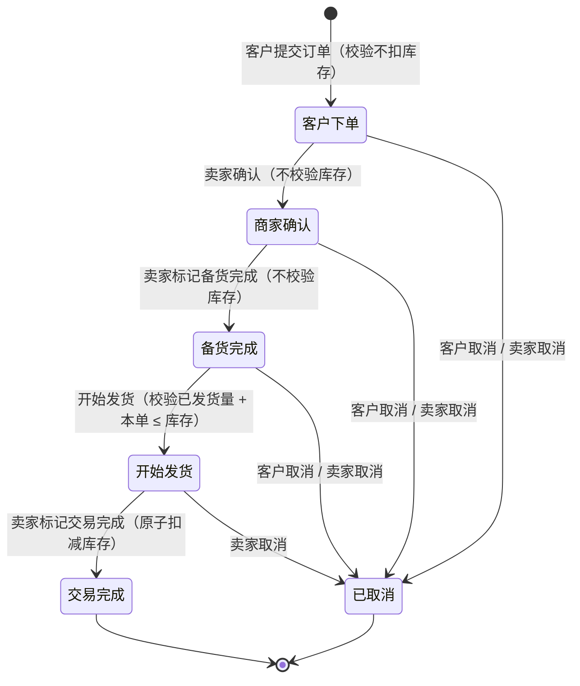
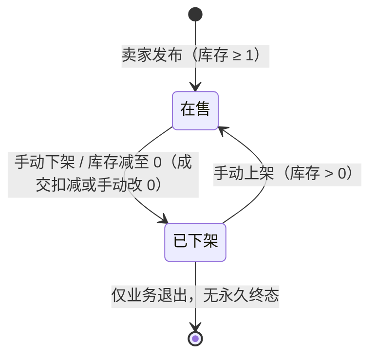
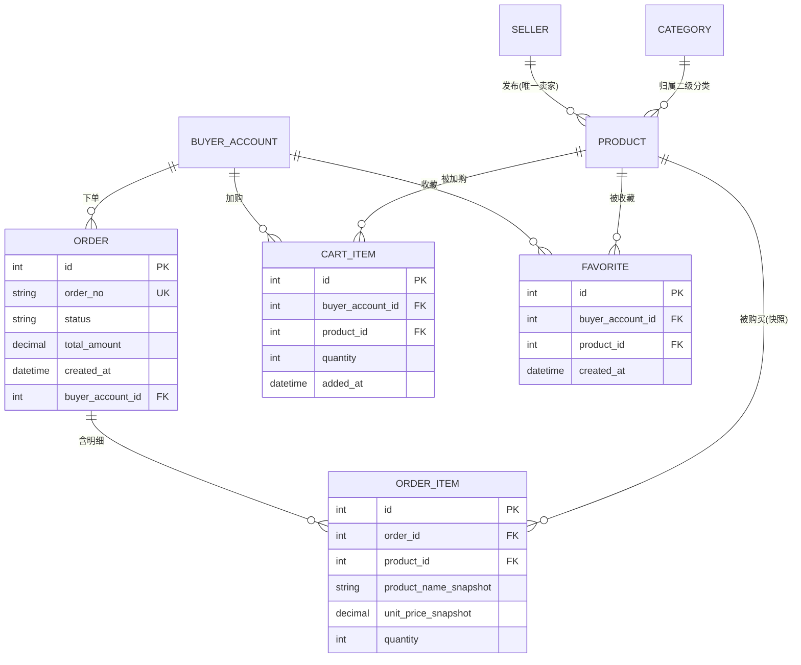

# 需求规格说明书（挑战需求B）

项目名称：在线购物系统（挑战升级B包）
文档版本：V1.5
编写日期：2026-11-06
文档状态：**需求基线**。业务方侧 0 条待答；变更请求 CR-B01（发货前容量校验，A-CL-B67）与 CR-B02（限时活动价，编辑范围扩展）均已获批；两处需求留白已按 A-CL-B65/B66 由团队补全为 RA-B6 / RA-B7；团队决策 D-B01~D-B14 已定；新增横向个性化需求 FR-B15（3.1.4）。

> **重要说明**：本文档是**基线 + 升级A 之上的增量升级包**。基线全部需求、升级A 全部需求（FR-A01~FR-A13）**默认继续生效**，仅在 1.2 列出的 4 项被本包替代/废除。B 与 A 是**迭代叠加关系，不是二选一**（A-CL-B48）。

---

## 1 引言

### 1.1 编写目的

本文档定义在线购物系统升级需求B 的功能与非功能需求，作为设计、开发、测试、验收的依据。上位基准为基线 SRS v3.0 与《需求规格说明书（挑战需求A）》V2.1，**未特别说明处一律遵从 A 包口径**。

### 1.2 项目范围

| 类型                 | 内容                                                                                                                                                                                           |
| ------------------ | -------------------------------------------------------------------------------------------------------------------------------------------------------------------------------------------- |
| 继承                 | 基线 MVP + 升级A 全部能力保留：账号体系（注册/登录）、商品发布与编辑、二级分类、库存与自动下架、多图与富媒体描述、分类筛选与搜索、卖家查看客户、商品隔离执行、存量匿名意向只读归档（RA5）                                                                                          |
| **被 B 替代/废除（4 项）** | ①「提交购买意向」动作**下线**；②意向排队机制（先到先得、冻结、递补）**下线**；③「每商品仅 1 笔交易」限制**废除**；④商品「已冻结（交易中）」状态**删除**（A-CL-B48 / A-CL-B49）                                                                                 |
| 升级需求B（增量）          | 1.收藏（收藏/取消收藏/列表）；2.购物车（加购、数量调整、勾选多件下单、转收藏）；3.订单（下单、商家确认、备货完成、开始发货、交易完成、取消）；4.买家订单历史；5.卖家订单查看与状态推进；6.商品状态收敛为「在售 / 已下架」两态；7.**限时活动价（横向个性化需求）**：卖家为特定商品设置双十一等限时特价，活动期内按活动价展示与下单（FR-B15，见 3.1.4） |
| 不在本包范围             | 在线支付、退款/售后、主动通知（站内信/短信/邮件）、状态超时自动流转、数据迁移（A-CL-B48 / B57 / B60 / B66）                                                                                                                         |

> **单卖家前提**：系统为**单卖家自营**，仅一个卖家账号，负责全部商品发布与交易，订单全部归属该唯一卖家 —— **无多商家、无店铺归属、无跨商家拆单**（A-CL-B46）。

### 1.3 术语与缩写

| 术语        | 含义                                                                                  |
| --------- | ----------------------------------------------------------------------------------- |
| 订单        | 客户对一件或多件商品的购买请求，含多商品明细，5 个推进状态 + 1 个取消状态                                            |
| 订单明细      | 订单内一行记录，含商品名、单价、数量的**下单时快照**                                                        |
| 整单流转      | 订单状态作用于整张订单，不逐商品独立流转（A-CL-B25）                                                      |
| **有效在途量** | 某商品所有「已确认且未完成」订单（商家确认 / 备货完成 / 开始发货）的明细数量之和；**仅用于展示与超量预警，不作拦截依据**（A-CL-B63 / D-B02） |
| **已发货量**  | 某商品所有「开始发货」状态订单的明细数量之和（货已出、未成交）；**是发货前容量校验的唯一输入**（A-CL-B67 / D-B13）                 |
| 库存快照      | 订单明细中的商品名、单价、数量取下单当时的值，后续商品变更不回写（A-CL-B50）                                          |
| 已取消       | 独立订单状态（A-CL-B53），与「交易完成」互斥，文案统一不区分取消方                                               |
| 账实分离      | 库存是**账面数**，发货后实物已交付但账面未扣，故「账面有库存」≠「还有货可卖」（RA-B2 第 10 条）                             |
| 历史商品      | 「已下架」商品的统称；B 包不存在永久终态（A-CL-B49）                                                     |
| 只读心愿单     | 收藏的定性：可查看、可点进商品详情，**无加购/下单入口**（A-CL-B51）                                            |
| **活动价**   | 卖家为特定商品设置的限时特价（如双十一活动价）；活动期内替代发布价用于展示与下单计价，**必须 > 0**（FR-B15 / CA-B10）              |
| **适用价**   | 下单瞬间按活动起止时间判定的实际成交单价；**快照单价 = 适用价**，活动结束后不回写（A-CL-B50）                              |

> 「意向」「排队」「冻结」「递补」等 A 包术语随机制下线，本文档不再使用。

### 1.4 参考文献

| 序号  | 类别   | 名称                                      |
| --- | ---- | --------------------------------------- |
| 1   | 标准   | IEEE Std 830-1998                       |
| 2   | 标准   | ISO/IEC/IEEE 29148:2018                 |
| 3   | 基线文档 | 在线购物系统需求规格说明书 v3.0（基线MVP）               |
| 4   | 上位文档 | 《需求规格说明书（挑战需求A）》V2.1                    |
| 5   | 澄清记录 | `澄清提问清单（挑战需求B）.md`（11 轮澄清，A-CL-B01~B67） |
| 6   | 落地清单 | `禅道录入清单（挑战需求B）.md`（14 条 FR + OUT-B01）   |

---

## 2 总体描述

### 2.1 产品视角

在基线 + 升级A 之上替换交易模型、收敛商品状态：

1. **交易模型替换**：「提交意向 → 先到先得排队 → 线下交易」整体改为「**加购物车/直接下单 → 订单状态流转 → 线下交易**」。不存在「又排队又下单」的并存（A-CL-B01）。
2. **商品状态收敛**：删除「已冻结（交易中）」态，仅保留 `在售 ⇄ 已下架`；「已下架」**不是终态**，补货后可手动上架；商品**不可物理删除**（A-CL-B49）。
3. **库存三道关卡**：`下单校验` → `发货前容量校验`（A-CL-B67）→ `成交扣减`；**库存只在成交时扣减**，前两道只读不写、不预占。`客户下单 / 商家确认 / 备货完成` 段不做任何占位（A-CL-B63）；**库存减至 0 一律自动下架**（A-CL-B02 / A-CL-B62）；有非终态订单时禁止手动下架与手动改 0（A-CL-B64）。
4. **单卖家自营**：订单与商品无商家归属维度，购物车多件下单不拆单（A-CL-B46）。
5. **线下交易延续**：无在线支付，价格发布时确定、不可议价；订单不含地址字段（默认交易地点为账号级选填项，不入订单）（A-CL-B59）。

**一句话概括本版本的设计主张**：*谁能拿到货在「开始发货」定，钱和账在「交易完成」结* —— 拦截永远发生在交付之前，结算永远发生在交付之后。

### 2.2 用户特征

| 角色       | 描述                                                           |
| -------- | ------------------------------------------------------------ |
| 匿名访客     | 可免登录浏览商品、分类筛选、搜索；不能加购、收藏、下单，触发时引导登录。                         |
| 注册买家     | 登录后可加购、收藏、下单；可查看本人订单历史（含已取消）；**「备货完成」及之前可整单取消**；不能改单、不能推进状态。 |
| 卖家（唯一账号） | 发布与管理商品、上下架、调整库存；查看全部商品订单；**手动推进全部订单状态**；交易完成前可取消任意订单。       |
| 平台管理员    | **本版本不存在该角色**（沿用 A-CL-09）。                                   |

### 2.3 假设与依赖

- 继承基线 + A 包全部假设与依赖（Docker、Maven、MySQL/SQLite、Jenkins、Git、JUnit、Selenium、禅道）。
- 假设：**数据迁移不在需求范围内**（A-CL-B48），需求仅约束切换后态的行为。
- 假设：无在线支付、无退款/售后、无短信/站内信通知、无状态超时自动流转 —— 均由业务方明确不做（A-CL-B57 / B60 / B66）。
- 假设：商品编辑范围**沿用 A 包 A-CL-16** —— 发布后仅可改库存数量与所属类别，名称/价格/描述/图片不可改（A-CL-B58，跨包冲突 C-B4 见 5.1 注）。
- 依赖：订单功能依赖 A 包账号体系（登录态）与商品在售状态。

### 2.4 需求约束

继承基线 C1-C5、升级A CA-1~CA-8；B 包新增约束 CA-B1~CA-B10。

| 序号    | 约束项       | 要求                                                                                                  |
| ----- | --------- | --------------------------------------------------------------------------------------------------- |
| CA-B1 | 兼容约束      | 基线验收场景 A1-A11 与升级A 的 AA-01~AA-09 必须继续通过，**例外**：涉及「提交意向、意向排队、冻结、递补、每商品仅 1 笔交易」的场景随机制下线，由 AB-01 替代验证。 |
| CA-B2 | 库存非负      | 库存为**非负整数**；一切扣减使用条件更新（`stock >= n` 才扣），影响行数为 0 即视为不足，**任何路径不得出现负库存**。                              |
| CA-B3 | 不超卖       | **三道库存关卡**：下单校验 → **发货前容量校验**（`已发货量 + 本单 ≤ 库存`）→ 成交原子扣减。拦截必须发生在**线下交付之前**（A-CL-B67）；并发下由条件更新保证不超卖。  |
| CA-B4 | 整单流转      | 订单状态作用于整张订单，不逐商品流转；只支持**整单取消**，不支持部分取消。                                                             |
| CA-B5 | 订单不可逆     | 「交易完成」与「已取消」为两条互斥终止态；完成与取消后均不可回退、不可再推进；订单**不可删除**。                                                  |
| CA-B6 | 单卖家       | 系统仅一个卖家账号，订单/商品接口不做商家归属过滤。                                                                          |
| CA-B7 | 商品不可删     | 商品只可下架，无物理删除；所有查询入口保留订单快照完整性。                                                                       |
| CA-B8 | 无售后       | 无退货、退款、售后流程；取消订单不涉及退款。                                                                              |
| CA-B9 | **口径不混用** | 「在途量」只能用于展示，「已发货量」只能用于发货校验，**不得互相替代**（D-B13）。二者定义见 1.3 与 RA-B2 第 7 条。                               |

| CA-B10 | 活动价约束 | 活动价必须 **> 0**；每个商品同时**最多 1 个活动**（不与其他价格规则叠加）；活动起止边界以**服务端时间**判定；活动只改价格，**不改变库存三道关卡与订单状态机**（FR-B15）。 |

### 2.5 编号与标注约定

| 前缀               | 含义                     | 可变更性            |
| ---------------- | ---------------------- | --------------- |
| `FR-Bxx`         | 功能需求（15 条）             | 走变更流程           |
| `OUT-B01`        | 明确不做清单                 | 走变更流程           |
| `RA-Bx`          | 业务规则                   | 规则正文走变更；实现细节可调整 |
| `NFR-Bxx`        | 非功能需求                  | 走变更流程           |
| `AB-xx`          | 验收场景（17 条）             | 随 FR/RA 变更同步    |
| `CA-Bx`          | 需求约束                   | 走变更流程           |
| **`A-CL-Bxx`**   | **业务方裁定**（不可由团队改写）     | **仅业务方可变更**     |
| **`D-Bxx`**      | **团队决策**（业务方未定义处由团队补全） | 团队可改，须留痕        |
| `T-Bxx` / `C-Bx` | 留痕项 / 冲突处置记录（仅正文无落点者）  | 只记录，不实现         |

> 答辩与评审时**不得把 `D-Bxx` 表述为业务方裁定**（参照 A 包 A-CL-09 的教训）。本包共业务方裁定 26 条、团队决策 14 条、留痕 3 条（另 4 条已并入正文，见 5.3 说明）。

---

## 3 具体需求

### 3.1 功能需求（FR-B01~FR-B15）

#### 3.1.1 买家端

| 编号     | 名称          | 优先级 | 需求描述                                                                                                                                                                                                                                    |
| ------ | ----------- | --- | --------------------------------------------------------------------------------------------------------------------------------------------------------------------------------------------------------------------------------------- |
| FR-B01 | 客户创建订单（下单）  | 高   | 登录后对在售商品下单，订单进入「客户下单」；下单**只校验不扣减**库存（`库存 ≥ 明细数量`，不足提示缺货并拦截整单）；金额取发布价、不可议价；订单无商家归属；**全站不存在「提交意向」入口**（A-CL-B01 / B02 / B46 / B48）。                                                                                                        |
| FR-B04 | 客户取消订单      | 高   | 「客户下单 / 商家确认 / 备货完成」三态可取消，「开始发货」起客户不可取消；**整单取消**、不可逆、需二次确认；取消后进入**独立状态「已取消」**（非共用交易完成），文案不区分取消方；不记录取消时间与原因；**无部分取消、无改单入口**；不涉及退款；因下单未扣库存，取消**无需回补**（A-CL-B13 / B53 / B54 / B57 / B59 / B60）。                                            |
| FR-B07 | 商品收藏        | 中   | 登录后可收藏/取消收藏；同商品幂等去重、无数量上限；列表按收藏时间倒序、无筛选搜索；**只读心愿单**：仅可点进商品详情，**无加入购物车、无直接下单入口**；已下架商品保留显示但置灰不可点（A-CL-B51）。                                                                                                                              |
| FR-B08 | 加入购物车       | 中   | 登录后可加购；**支持同款多件**，条目含「数量」字段可调整（最小 1，减到 0 等同移除，上限 999）；同商品重复加购不新增条目；**加购阶段不校验、不锁定库存，数量不设库存上限**（改到 99 也能保存）；同一商品可同时在收藏与购物车；已下架商品置灰不可勾选（A-CL-B61 / D-B04）。                                                                                 |
| FR-B09 | 购物车多件商品下单   | 高   | 勾选 ≥1 条下单，生成**1 个订单含多商品明细**（每条含数量），5 状态**整单流转**；下单逐商品校验 `库存 ≥ 明细数量` 且在售，不足提示缺货并**拦截整单**，不扣减库存；下单成功后已勾选条目移出购物车，未勾选保留；空购物车/未勾选时「去结算」置灰（A-CL-B25 / B61）。                                                                                   |
| FR-B10 | 购物车多件商品转为收藏 | 低   | 勾选 ≥1 条转收藏，转换后从购物车移除；已在收藏中的商品跳过（去重）；已下架商品也可转收藏；**数量丢弃**，再入购物车重置为 1（D-B05）。                                                                                                                                                              |
| FR-B13 | 买家订单历史      | 中   | 记录单位由「意向」改为**订单**；字段固定为：订单号、商品清单（下单时快照：商品名/单价/数量）、总金额、订单状态、下单时间；时间倒序、每页 20 条、支持翻页；**只读**，无删除/搜索/筛选/导出；**不做独立详情页**，明细在列表行内展开（D-B01）；**已取消订单同样计入**历史，状态统一显示「已取消」，不区分取消方，且**不显示取消时间与原因**；订单不含地址字段（A-CL-B48 / B53 / B54 / B56 / B57 / B59）。 |

#### 3.1.2 卖家端

| 编号     | 名称          | 优先级 | 需求描述                                                                                                                                                                                                                                                                      |
| ------ | ----------- | --- | ------------------------------------------------------------------------------------------------------------------------------------------------------------------------------------------------------------------------------------------------------------------------- |
| FR-B02 | 商家确认订单      | 高   | 仅「客户下单」可确认；**确认不做任何库存校验、不锁库存、不预占**（A-CL-B63）；容量校验发生在下一步「开始发货」，见 FR-B03；确认后置「商家确认」。                                                                                                                                                                                        |
| FR-B03 | 备货完成与开始发货   | 高   | 「商家确认」→「备货完成」→「开始发货」均由卖家手动推进；**「备货完成」不校验库存**；**「开始发货」是唯一带库存校验的推进动作**：校验 `已发货量 + 本单数量 ≤ 当前库存`，满足则允许发货（库存不变），不满足则**拒绝发货**、订单停在「备货完成」，提示缺口（商品名 / 需要 N / 当前 M / 已发货 K），卖家可补货后重试或取消（RA-B2 第 4 条 / A-CL-B67）。                                                                   |
| FR-B05 | 商家取消订单      | 中   | 「客户下单 / 商家确认 / 备货完成 / 开始发货」四态均可取消（交易完成前均可，含已发货）；无退款、无召回；「交易完成」后不可取消；取消后进入「已取消」，文案不区分取消方；不记录取消时间与原因（A-CL-B05 / B14 / B54 / B57）。                                                                                                                                           |
| FR-B11 | 标记交易完成与库存扣减 | 高   | 仅「开始发货」可标记完成；标记前**逐商品二次校验**库存，全部满足则**按明细数量原子扣减**并置「交易完成」；任一不足则**拦截成交**（并发兜底），订单停在「开始发货」，提示缺口与在途单数，卖家可补货后重试或取消；扣减后库存为 0 的商品**自动下架**；交易完成后不可取消、不可回退（RA-B2 第 5 条 / RA-B6）。                                                                                                   |
| FR-B12 | 商品状态与上下架    | 中   | 商品状态仅 `在售 / 已下架` 两态，无「已冻结」、**无永久终态**；下架原因两类：**手动下架** / **库存减至 0 自动下架**（成交扣减或卖家手动改库存为 0 均触发）；补货后仍为已下架，须手动上架；**不提供删除**；已下架商品在列表/搜索不出现、详情打不开、购物车置灰、收藏置灰；编辑范围沿用 A-CL-16（A-CL-B49 / B58 / B62）。**保守约束**：商品存在任何非终态订单时，**禁止手动下架、禁止把库存手动改为 0**，须先处理完订单；成交扣减导致的自动下架不受此限（A-CL-B64）。 |
| FR-B14 | 卖家订单查看与状态推进 | 高   | **不新建全局订单列表、不做按状态筛选**（A-CL-B55）；卖家通过三个既有入口查看与操作：①每个客户的购买历史（对应 A 包 FR-A11）②每个商品的订单记录 ③后台状态推进入口；订单字段严格为 5 项；操作按钮按当前状态显示（确认/备货完成/开始发货/交易完成/取消）；已取消订单仍出现在 ① ② 中、只读；**不另设订单历史归档模块**；同商品待发货订单**默认按创建时间升序**展示但不强制成交顺序；卡单按 RA-B7 标红/置顶（A-CL-B55 / B57 / D-B06 / D-B11）。           |

#### 3.1.3 系统与范围声明

| 编号      | 名称      | 需求描述                                                                                                                                                                  |
| ------- | ------- | --------------------------------------------------------------------------------------------------------------------------------------------------------------------- |
| FR-B06  | 订单状态机   | 状态共 **6 个**：客户下单 / 商家确认 / 备货完成 / 开始发货 / 交易完成 / **已取消**；前四态任一可进入已取消；5 个推进动作全部由卖家手动完成；严格按序、不可跳过、不可回退；非法流转一律拦截并提示；订单不可删除；**界面字段严格 5 项**，状态时间戳仅供排查（A-CL-B06 / B53 / B57）。 |
| OUT-B01 | 本版本明确不做 | 退货退款售后、修改订单、订单地址字段、取消时间与原因、独立订单详情页、全局卖家订单列表与状态筛选、收藏直接加购/下单、商品物理删除、库存预占、加购时的库存校验与数量上限拦截、「在售但库存 0」状态、超时自动取消/自动流转/自动补货、任何主动通知、强制先到先得的顺序锁（见 5.4）。                         |

#### 3.1.4 横向个性化需求

> **纵向 vs 横向**：FR-B01~FR-B14 为**纵向公共需求** —— 对所有商品、所有买家、所有交易成立的通用规则；本节为**横向个性化需求** —— 从**特定商品 / 特定用户 / 特殊销售模式**切入的差异化规则，只对满足条件的对象生效，且**不得突破纵向需求与 CA-B1~B10 的任何硬约束**。

| 编号     | 名称           | 优先级 | 需求描述                                                                                                                                                                                                                                                                                                                                     |
| ------ | ------------ | --- | ---------------------------------------------------------------------------------------------------------------------------------------------------------------------------------------------------------------------------------------------------------------------------------------------------------------------------------------- |
| FR-B15 | 限时活动价（双十一特价） | 中   | **特定商品维度**。卖家可为在售商品设置限时活动价：① 字段为活动价（**必须 > 0**）与起止时间，每商品同时**最多 1 个活动**；② 活动期内，买家端详情页/购物车按**活动价**展示并划线显示原价，下单按**适用价**计价并生成快照；③ 活动结束**自动恢复发布价**（规则计算，非编辑商品数据）；④ 活动开始/结束边界的并发下单以**服务端时间**判定，各按当时适用价定格快照；⑤ 商品下架则活动自然失效；⑥ 活动**不改变库存三道关卡**（下单校验 / 发货前容量校验 / 成交扣减照旧）、**不引入预占与秒杀语义**、不影响订单 6 态状态机（CA-B10；对 A-CL-16 编辑范围的扩展经 CR-B02 批准，留痕 T-B08）。 |

### 3.2 业务规则

#### RA-B1 订单状态机



| 迁移              | 触发者              | 前置条件                             | 副作用                       |
| --------------- | ---------------- | -------------------------------- | ------------------------- |
| 创建 → 客户下单       | 客户               | 登录；商品在售；`库存 ≥ 明细数量`              | 不扣库存；生成订单与明细快照            |
| 客户下单 → 商家确认     | 卖家               | 状态合法（**不校验库存**，A-CL-B63）         | 无库存变化（不扣、不锁、不预占）          |
| 商家确认 → 备货完成     | 卖家               | 状态合法（**不校验库存**）                  | 无库存变化                     |
| **备货完成 → 开始发货** | 卖家               | **`已发货量 + 本单数量 ≤ 库存`**（A-CL-B67） | 无库存变化；通过后货即交付             |
| 开始发货 → 交易完成     | 卖家               | 逐商品 `库存 ≥ 明细数量`（并发兜底）            | 按数量原子扣减；库存归 0 商品自动下架；订单只读 |
| 任一前四态 → 已取消     | 客户（前三态）/ 卖家（前四态） | 未达交易完成                           | 状态置「已取消」；库存不变（从未扣减）       |

> 终止态：`交易完成` 与 `已取消` 互斥，均不可回退、不可再推进；订单不可删除。
>
> 注意「客户下单 → 商家确认 → 备货完成」三段**均不校验库存**，这是业务方口径（A-CL-B63），不是遗漏。测试若在此处判定"应当拦截"，属误判（见 AB-05）。

#### RA-B2 库存与不超卖规则（核心）

> ✅ **口径已定（业务方裁定）**：**三道关卡** —— `下单校验` → `发货前容量校验` → `成交扣减`。库存**只在成交时扣减**；前两道只读不写、不预占。
>
> **演进说明（写作留痕，供复盘）**：V1.0 曾把容量校验放在「商家确认」，因业务方「库存只有两步」的表述被撤销（C-B6）；V1.3 经变更请求 CR-B01 改为放在「开始发货」之前，业务方批准（A-CL-B67：*在"货没交、钱没收"的节点停下，让卖家补货或取消，是合理的；只认"不超卖、不出现负库存"两个结果*）。

1. **非负约束**：库存为非负整数；一切扣减使用条件更新 `stock = stock - n WHERE id = ? AND stock >= ?`，影响行数为 0 即判定不足，**任何路径不得出现负库存**（硬约束，不可放宽）。

2. **第一道关卡 · 下单校验**：下单时逐商品校验 `库存 ≥ 明细数量`，不足则提示缺货并拦截整单；**不扣减、不预占、不锁定**。

3. **零校验区 · 前段**：`客户下单 → 商家确认 → 备货完成` 三个动作**不查库存、不占位**（A-CL-B63 保留至此）；卖家改库存也不以在途量为下限。

4. **第二道关卡 · 发货前容量校验（核心）**：点「开始发货」时，逐商品校验

   ```
   已发货量 = 该商品所有「开始发货」状态订单的明细数量之和（货已出、尚未成交）
   通过条件：已发货量 + 本单明细数量 ≤ 当前库存
   ```

   - **满足** → 允许发货，状态置「开始发货」，库存不变；
   - **不满足** → **拒绝发货**，订单停在「备货完成」，提示 `需要 N / 当前 M / 已发货 K`；
   - 拒绝后出路两条：**补货后重试发货** 或 **卖家手动取消**（买家亦可自行取消，见 RA-B7 第 6 条）。

   > **为什么用「已发货量」而非「在途量」**：`商家确认 / 备货完成` 的订单货还没出门，不占用实物额度。若按「在途量」校验，库存 1、A/B 两单都在备货时，A 也会被判 `在途 2 > 库存 1` 而**发不出去**，等于「要么都能发、要么都别发」，卖家被迫先补货或先取消一单。按「已发货量」校验则先到者得：A 通过（0+1≤1）、B 被拒（1+1>1），符合直觉（D-B13）。
   >
   > **这道校验足够收口**：通过后恒有 `已发货量 ≤ 当前库存`，因此成交时每笔都能扣，第 5 条兜底仅用于并发窗口。

5. **第三道关卡 · 成交扣减（并发兜底）**：标记「交易完成」时逐商品校验 `库存 ≥ 明细数量`，满足则**原子扣减**并置完成；不足则**拦截成交**，订单停在「开始发货」，提示缺口，卖家补货重试或取消。此处**不得放行、不得负库存**。

   > 第 4 条已解决绝大多数情形，第 5 条仍必须保留 —— 两笔订单**并发**点「开始发货」时可能都通过读检查（非原子），此时由扣减的条件更新兜住，保证最终不超卖。

6. **取消无需回补**：取消订单不扣不减、不做回补 —— 与「下单不扣库存」口径统一。业务方「取消后各商品 +1 回补」的表述与此等价（取消前从未扣减），记 T-B01 留痕。

7. **在途量与已发货量（两个口径，不得混用，CA-B9）**：

   | 量        | 定义                              | 用途                                               |
   | -------- | ------------------------------- | ------------------------------------------------ |
   | **在途量**  | 状态 ∈ {商家确认, 备货完成, 开始发货} 的明细数量之和 | **仅用于展示与预警**：商品列表「库存 X / 在途 Y」，`Y ≥ X` 飘红（D-B02） |
   | **已发货量** | 状态 = 开始发货 的明细数量之和               | **第 4 条校验的唯一输入**                                 |

   两者差值 = 已确认但尚未出库的数量，业务含义是「潜在需求」。展示用宽口径（预警早）、校验用窄口径（不误伤），**实现时禁止把两者写成同一个变量或同一方法名**。

8. **并发与幂等**：同一订单重复点击「开始发货 / 交易完成」由状态前置判断保证幂等；`开始发货` 的读检查建议在同一事务内对商品行加锁（`SELECT ... FOR UPDATE`）以缩小并发窗口，未加锁时的极小窗口由第 5 条兜底 —— **两种实现都不产生负库存或超卖**（D-B14，见 5.2）。

9. **商品侧保守约束**：存在非终态订单时，禁止手动下架与手动改库存为 0（A-CL-B64，见 RA-B3 第 8 条）。

10. **账实分离提醒**：库存是**账面数**，发货后实物已交付但账面未扣；因此「账面有库存」不等于「还有货可卖」，判断可卖量须以 `库存 − 已发货量` 为准。这是本设计的固有窗口，由第 4 条在交付前收口。

11. **风险收窄（T-B05 修订）**：卡单位置由「开始发货」前移到「**备货完成**」，此时**货未交付、钱未收**，卖家补货或取消即可；买家在「备货完成」仍可自行取消（客户取消窗口含该状态），**原"买家无出口"问题已消除**（T-B06）。

#### RA-B3 商品状态机（收敛为两态）



1. 删除 A 包「已冻结（交易中）」态 —— 订单机制不需要冻结商品（A-CL-B49）。
2. 「已下架」**不是终态**：B 包不存在「交易成功后永久进历史、不可再上架」的设定；「历史商品」即「已下架」的统称。
3. 下架原因两类：`手动下架`（卖家点按钮）/ `库存耗尽自动下架`（库存减至 0，触发者可以是成交扣减，也可以是卖家手动改库存为 0）；业务方所称「交易成功下架」合并入后者（C-B2）。
4. **不存在「在售且库存 0」**：库存减至 0 一律自动下架（A-CL-B62）。
5. 补货（改回正数）后仍为「已下架」，须卖家**手动上架**（沿用 A 包 C-2 裁定）。
6. 商品**不可删除**，只能下架（A-CL-B49）。
7. 已下架商品：列表与搜索不出现、详情打不开、购物车条目置灰不可勾选、收藏条目置灰不可点。
8. 商品存在**非终态订单**（客户下单 / 商家确认 / 备货完成 / 开始发货）时：**禁止手动下架**，也**禁止把库存手动改为 0**；系统拦截并提示「存在进行中的订单，请先处理完订单」。处理完毕后（订单全部交易完成或已取消）才可执行（A-CL-B64）。
9. **自动下架不受第 8 条限制**：成交扣减把库存打到 0 时照常自动下架，即便此时还有别的非终态订单；这些订单**继续正常推进**（成交时按 RA-B2 第 5 条校验，不足则拦截）。
10. **上架不受在途限制**：只要库存 > 0 即可手动上架，不因存在在途订单而阻止；在途 ≥ 库存时界面飘红提示（D-B09）。

#### RA-B4 收藏与购物车规则

| 规则    | 内容                                                 |
| ----- | -------------------------------------------------- |
| 收藏方向  | **单向**：购物车 → 收藏（可多件）。收藏 → 加购 / 下单**无入口**（A-CL-B51） |
| 收藏定性  | 只读心愿单：列表仅可点进商品详情                                   |
| 购物车数量 | 支持同款多件，数量可调；最小 1（减到 0 等同移除）、最大 999（D-B04）          |
| 加购库存  | **加购不校验、不锁库存、不设库存上限**；库存是否满足留到下单校验（A-CL-B61）       |
| 去重    | 同一商品在购物车/收藏中各只 1 条，重复加购/收藏不新增条目                    |
| 并存    | 同一商品可同时在收藏与购物车（A-CL-B23 沿用）                        |
| 失效处理  | 已下架商品在购物车/收藏中置灰；下单时含失效商品则拦截整单                      |
| 数量超库存 | 下单被拦后**不自动修改购物车数量**，只提示缺货，由客户自行调整（D-B10）           |
| 转收藏   | 购物车转收藏后从购物车移除，**数量丢弃**（D-B05）                      |

#### RA-B5 A 包能力下线与迁移规则

| A 包能力               | B 包处置  | 规则                                     |
| ------------------- | ------ | -------------------------------------- |
| 提交购买意向（FR-A03）      | **下线** | 全站无「我要购买/提交意向」入口；购买入口统一为「加入购物车 / 立即下单」 |
| 买家历史意向（FR-A04）      | **改造** | 记录单位由「意向」改为「订单」→ 由 FR-B13 承接           |
| 每商品仅 1 笔交易（A-CL-15） | **废除** | 库存允许前提下可同时存在多笔未完成订单；不超卖由 RA-B2 保证      |
| 商品「已冻结（交易中）」（RA1）   | **删除** | 商品状态机收敛为两态，见 RA-B3                     |
| 意向排队 / 冻结 / 递补（RA2） | **下线** | 由订单状态机替代，见 RA-B1                       |
| 存量匿名意向归档（RA5）       | **保留** | 口径不变，仍为只读归档                            |

#### RA-B6 多订单争库存的裁决规则（需求留白，团队补全）

> **需求背景**：B 包废除「先到先得排队」后，多笔订单可争同一商品的最后库存。需求方明确**未规定任何顺序规则**，并把该规则交由团队补全，要求用两条硬约束（**不得负库存、必须避免超卖**）反向校验（A-CL-B65）。
>
> 业务方原话：*订单没有「先到先得」规则 —— 那套是挑战A 购买意向排队用的，已经废弃了。多笔订单争最后库存时，按什么顺序成交、谁优先，需求没写。*

**方案取舍（团队决策 D-B11）**

| 方案                    | 是否满足硬约束      | 副作用                                     | 结论     |
| --------------------- | ------------ | --------------------------------------- | ------ |
| A 强制先到先得（前者未成全后者不可成交） | 满足（不超卖与顺序无关） | 与「状态由卖家手动推进」冲突；卖家想合并配送时被系统挡住；需额外实现"顺序锁" | 不采用    |
| B 完全无序（谁点谁成交，列表无排序约束） | 满足           | 先下单者可能永远买不到，纠纷无依据；答辩易被诘问「不公平」           | 不采用    |
| **C 默认先到先得（排序）+ 不强制** | 满足           | 无                                       | **采用** |

**规则（C 方案）**

1. **分配裁决发生在「开始发货」**：谁能拿到货，由 RA-B2 第 4 条容量校验一次裁决；「交易完成」只做账面扣减与并发兜底，不参与分配。
2. **默认顺序 = 订单创建时间升序**：同商品的待发货订单**默认按 `created_at` 升序排列**，使「先到先得」成为**默认行为而非硬规则**。
3. **不强制**：系统不禁用后创建订单的「开始发货 / 交易完成」按钮，卖家可自行选择先发哪一单（实际业务中常需按备货状况、配送批次决定）。
4. **裁决依据只有库存**：能否通过由 `已发货量 + 本单 ≤ 库存`（发货）/ `库存 ≥ 明细数量`（成交兜底）决定，**顺序不影响是否超卖**。
5. **禁止部分成交**：不得少扣、不得拆单、不得按「剩多少扣多少」成交（违反 CA-B4 整单流转）。
6. **失败者提示到具体竞争对象**：拦截时提示「库存不足（需要 N / 当前 M / 已发货 K）」，帮助卖家决策。
7. **不引入队列语义**：不存在排队位次、不存在自动递补、不存在「轮到你了」的提示 —— 与 A 包排队机制彻底切割（A-CL-B01）。

> **硬约束校验**：规则 4 的两处判定均由只读校验 + 条件更新实现，**任意操作顺序下都不可能出现负库存或超卖**；规则 2 的排序是只读展示，不参与扣减，不构成并发风险。

#### RA-B7 卡单兜底规则（需求留白，团队补全）

> **需求背景**：需求方明确**没有任何兜底** —— 没有列表标红、没有超时自动取消、没有其他机制，取消只有手动一种（A-CL-B66）。因此「卡单」必须由团队用**不违反既有约束**的方式补全。

**前提约束（不可突破）**

- 无站内信、无短信、无邮件 —— 系统**不能主动通知**（沿用 A 包）；
- 不做超时自动流转、不做自动取消（会误杀已发货订单、且与「状态全由卖家手动推进」冲突）；
- 兜底手段**不得引入自动扣减、自动改状态**，否则绕过 RA-B2 的三道关卡。

**规则（只做可见性兜底，不做自动化）**

1. **商品侧标记**：商品列表中，若「有效在途量 > 库存」，该商品显示 `库存不足 · N 单待发货` 并飘红（D-B02）。
2. **订单侧标记**：订单停在「**备货完成**」且点「开始发货」被拒时，该单标记 `无法发货（库存不足）`，并在卖家订单视图中**置顶**于同状态订单之前。
3. **缺口可视化**：标记处展示 `需要 N / 当前 M / 已发货 K`，卖家无需点开即可判断是补货还是取消。
4. **停留时长展示**：展示该单在当前状态的停留天数（`已停留 X 天`，自进入「备货完成」起算）—— **仅展示，不触发任何动作**。
5. **卖家出路两条**：`补货后重试发货` 或 `手动取消`。系统不提供第三条路（不自动取消、不自动退款、不改单）。
6. **买家侧有出口**：订单卡在「备货完成」时，买家**可自行整单取消**（客户取消窗口覆盖该状态，A-CL-B13），无需依赖卖家 —— 卖家侧提示与买家自助取消共同构成完整出路。
7. **长期卡单不影响一致性**：订单停留多久都不会造成超卖或负库存，只是业务效率问题，故不做自动清理。
8. **成交阶段仍可能出现的卡单**：仅当两单并发点「开始发货」都通过、并在成交时被条件更新拦截时才出现（概率极低），此时订单停在「开始发货」，按本条 2~5 款同样提示与处理。

> **硬约束校验**：全部兜底手段均为**只读展示**（规则 1~4、8）或**既有手动操作**（规则 5、6），不含任何自动库存变动 → 不可能产生负库存或超卖。
>
> ✅ **T-B06 已消除**：V1.2 时卡单发生在「开始发货」（已发货、买家不能取消、无通知）；V1.3 起卡单位置前移到「备货完成」，**买家仍可自行取消**，故「买家无出口」问题不再存在。

### 3.3 非功能需求（继承基线 NFR-01~06、A 包 NFR-A01~A06，新增 NFR-B）

| 编号      | 类别   | 描述                                                                 |
| ------- | ---- | ------------------------------------------------------------------ |
| NFR-B01 | 性能   | 商品列表/搜索 P95 < 800ms；购物车、订单列表 P95 < 800ms；成交扣减单事务耗时 < 200ms。        |
| NFR-B02 | 安全   | 下单、加购、收藏、取消、状态推进均需登录鉴权；买家仅能访问本人订单与购物车，越权返回拒绝；扣减使用参数化条件更新，防注入与并发超卖。 |
| NFR-B03 | 一致性  | 库存与商品状态强一致：任何时刻不存在「在售且库存 0」；订单总额 = Σ(单价 × 数量) 且与快照一致。              |
| NFR-B04 | 可用性  | 关键操作给出成功/失败提示；**下单缺货与发货被拒均提示到具体商品与缺口数量**；状态按钮重复点击有幂等保护。            |
| NFR-B05 | 可维护性 | 新增模块单元测试覆盖率 ≥ 60%；订单状态迁移、库存口径判断均集中在一处，禁止散落。                        |
| NFR-B06 | 可移植性 | Docker 一键部署，兼容基线 + A 包部署方案。                                        |
| NFR-B07 | 审计   | 订单状态变更、库存扣减、上下架、取消等关键操作记录时间戳（仅供排查，**不作为界面字段**）。                    |

### 3.4 外部接口

| 接口类型   | 名称             | 内容                                                                                   |
| ------ | -------------- | ------------------------------------------------------------------------------------ |
| UI（买家） | 商品详情页          | 加入购物车（含数量）、立即下单、收藏；已下架商品不可访问                                                         |
| UI（买家） | 购物车页           | 数量增减、勾选多条、去结算、转为收藏、失效商品置灰                                                            |
| UI（买家） | 收藏页            | 收藏列表、取消收藏、点进商品详情（**无加购/下单按钮**）                                                       |
| UI（买家） | 我的订单页          | 订单历史（5 字段 + 行内展开明细）、整单取消入口（仅前三态）                                                     |
| UI（卖家） | 商品管理页          | 库存调整、手动上下架、库存/在途展示；无删除入口；在途超库存飘红                                                     |
| UI（卖家） | 客户购买历史页        | 沿用 A 包「全部顾客 + 单客户历史」，历史内容改为订单维度，含状态与操作按钮                                             |
| UI（卖家） | 商品订单记录页        | 按商品查看相关订单，可推进状态；卡单置顶并标注缺口                                                            |
| 软件     | 数据库            | MySQL/SQLite；新增 ORDER / ORDER_ITEM / CART_ITEM / FAVORITE 表；PRODUCT 增加在途量、已发货量两条派生查询 |
| 通信     | HTTP/HTTPS（继承） | REST 风格接口                                                                            |

### 3.5 数据需求



> 字段说明：
>
> 1. **订单实体严格只含 5 项业务字段**：订单号、状态、总金额、下单时间、买家（明细即「商品清单」）；**不含地址、不含取消时间、不含取消原因**（A-CL-B57 / B59）。
> 2. 订单明细存**下单时快照**（商品名/单价/数量），后续商品改价或下架不回写（A-CL-B50）。
> 3. `PRODUCT` 沿用 A 包结构，不新增商家维度；`SELLER` 恒为唯一一条记录（A-CL-B46）。
> 4. 「有效在途量」与「已发货量」均为派生查询，**均不落库**为独立字段，避免与订单数据不一致：
>    - 有效在途量（展示/预警）：`SUM(ORDER_ITEM.quantity)` where 订单状态 ∈ {商家确认, 备货完成, 开始发货}
>    - 已发货量（**发货校验输入**）：`SUM(ORDER_ITEM.quantity)` where 订单状态 = 开始发货
>      两者不得共用同一变量或同一方法名，否则会把校验口径写成展示口径（CA-B9 / D-B13）。
> 5. 状态枚举固化在代码常量，禁止散落字符串；状态迁移判断集中在一处（NFR-B05）。
> 6. **限时活动价（FR-B15）**：`PRODUCT` 扩展 3 个可选字段 —— `sale_price`（活动价，> 0）、`sale_start_at`、`sale_end_at`；**不新建活动表**（单卖家、单商品单活动，一对一字段即可）；适用价 = 服务端当前时间落在起止区间内取 `sale_price`，否则取发布价；活动价**不参与**在途量 / 已发货量等派生查询。

---

## 4 验收准则

### 4.1 通用前提

1. 基线验收项 V1-V4 与场景 A1-A11 **必须通过**；升级A 的 AA-01~AA-09 除下线项外**必须通过**（下线项由 AB-01 替代验证）。
2. B 包新增需求满足：V1 可复现；V2 单元/UI 测试通过；V3 异常处理完备；V4 与本文档一致。
3. RA-B2 的口径为**业务方裁定**：三道关卡 —— 下单校验、**发货前容量校验**（A-CL-B67）、成交扣减；`客户下单 / 商家确认 / 备货完成` 段零校验（A-CL-B63）。原「商家确认容量闸门」不实现（C-B6）。
4. **反直觉断言清单**（测试务必照此执行，否则会报假 Bug）：
   - 库存不足时，商家「确认」与「备货完成」**应当成功**（AB-05）；
   - 购物车数量可**大于**库存并成功保存（AB-03）；
   - 库存 1、两单竞争时，**先点发货的那单通过，后点的被拒**（AB-06 / AB-15）。

### 4.2 关键验收场景（AB-01~AB-18）

| 编号    | 场景                                                                                                                                                                                                                   |
| ----- | -------------------------------------------------------------------------------------------------------------------------------------------------------------------------------------------------------------------- |
| AB-01 | **能力下线**：全站不存在「提交意向 / 我要购买」入口；购买入口仅为「加入购物车 / 立即下单」；商品状态仅「在售/已下架」两值，不存在「已冻结」；同一商品可在库存允许下同时存在多笔未完成订单。                                                                                                                  |
| AB-02 | **下单不扣库存**：库存 5，下单 2 件 → 订单生成、状态「客户下单」、库存仍为 5；再下一单 3 件 → 同样成功、库存仍为 5。                                                                                                                                                |
| AB-03 | **加购不校验库存**：库存 5，加购后把数量改为 99 → **保存成功**；勾选下单 → 提示缺货并拦截整单，购物车条目保留（数量不自动修改）。                                                                                                                                           |
| AB-04 | **整单多明细**：购物车勾选 A（数量 2）与 B（数量 5）下单 → 生成 **1 个订单**含 2 条明细，总金额 = 2×A单价 + 5×B单价。                                                                                                                                        |
| AB-05 | **前段零校验**：库存 1，A 单（1 件）确认成功 → B 单（1 件）点「确认」**仍然成功**、点「备货完成」也**成功**（这两步不校验库存，A-CL-B63）；两单都停在「备货完成」，在途 2 > 库存 1（系统允许，界面飘红）。                                                                                            |
| AB-06 | **发货前容量校验（核心，A-CL-B67）**：接 AB-05，库存 1、已发货 0。① A 点「开始发货」→ **通过**（0+1≤1），货交付 A，库存仍为 1；② B 点「开始发货」→ **被拒**，提示 `需要 1 / 当前 1 / 已发货 1`，停在「备货完成」，**货未交付、钱未收**；③ 补货到 2 后重试 B 发货 → 通过（1+1≤2）；④ 若改取消 B → 状态「已取消」，库存不变。全程库存不为负。 |
| AB-07 | **成交扣减按数量 + 原子性**：明细 3 件、库存 5 → 标记交易完成 → 库存变 2；另一单明细 5 件、库存 3 → 被拦。并发两单同时点成交 → **仅一笔成功扣减**、另一笔被拦，库存**不为负、不双扣**；重复点击同一单不产生二次扣减。                                                                                       |
| AB-08 | **取消状态独立**：客户对「备货完成」订单取消 → 状态变「已取消」（非「交易完成」）；文案不含"客户取消/商家取消"；界面无取消时间、无取消原因；无退款提示；商家对「开始发货」订单同样可取消；「交易完成」订单无取消入口。                                                                                                     |
| AB-09 | **不可改单**：订单界面无「修改订单」「取消部分商品」入口；无地址字段；客户只能查看状态或整单取消。                                                                                                                                                                  |
| AB-10 | **商品不可删 + 自动下架**：商品管理页无删除按钮；**无任何订单时**卖家把库存手动改为 0 → 商品自动下架并从列表/搜索消失；补货改回 5 → 仍为已下架，点手动上架后恢复在售。                                                                                                                       |
| AB-11 | **订单快照**：下单后商品名称/价格不因任何操作变化；历史订单显示下单当时商品名与单价；商品下架后历史订单仍正常展示。                                                                                                                                                         |
| AB-12 | **收藏只读**：收藏列表无「加入购物车」「下单」按钮，仅可点进商品详情；已下架商品置灰不可点；购物车勾选多件可转收藏，转换后从购物车移除且数量丢弃。                                                                                                                                          |
| AB-13 | **历史与入口**：买家订单历史含已取消订单，状态统一「已取消」，字段恰为 5 项；卖家端三个入口（客户购买历史 / 商品订单记录 / 状态推进）均可见订单并操作，**不存在全局"全部订单"列表页，也不存在状态筛选控件**。                                                                                                     |
| AB-14 | **订单在途时的保守限制**：商品存在 1 笔「开始发货」订单时，卖家点「手动下架」→ 被拒并提示"存在进行中的订单"；把库存手动改为 0 → 同样被拒；改为其他正数可保存；该订单成交扣减至 0 → 商品**自动下架**（不受限制），订单正常完成；订单全部结束后，手动下架/改 0 恢复可用。                                                                   |
| AB-15 | **多单争库存（RA-B6）**：库存 1，A（先下单）、B（后下单）均在「备货完成」→ 同商品订单列表**默认 A 在前**（按创建时间升序）；A 点「开始发货」通过（0+1≤1），B 被拒（1+1>1）；**顺序不强制**：若卖家改先点 B，则 B 通过、A 被拒。全程无部分成交，系统**不出现**排队位次或"轮到你了"提示。                                               |
| AB-16 | **卡单兜底与买家出口（RA-B7）**：库存 1，B 发货被拒后停在「备货完成」→ 商品列表飘红 `库存不足 · N 单待发货`；该单标记 `无法发货（库存不足）` + `需要 1 / 当前 1 / 已发货 1` + `已停留 X 天`，并置顶；等待任意时长系统**不自动取消、不自动改状态、不发通知**；卖家补货到 2 → 重试发货成功；或**买家自行取消该单** → 状态「已取消」。                  |
| AB-17 | **并发发货（校验窗口兜底）**：库存 1，A、B 均在「备货完成」，**同时**点「开始发货」→ 若两者都通过读检查（非原子），两单均进入「开始发货」；随后一单成交扣至 0，另一单成交被拦（按 RA-B7 第 8 款处理），库存**不为负**。系统在**任何执行顺序**下都不出现负库存与超卖。                                                                 |

| AB-18 | **限时活动价（FR-B15，双十一）**：商品 P 原价 100，设活动价 80（11-01 ~ 11-11）。① 活动期内详情页显示 `¥80`（划线 ¥100），下单 2 件 → 总额 160、明细快照单价 80；② 活动结束后下单 → 按 100 计价；查看 ① 的历史订单 → 仍为 80 / 160（快照不回写）；③ 活动期内库存不足 → 下单拦截 / 发货校验 / 成交扣减**照常生效**；④ 活动价设为 0 → 被拒；活动未结束再设第二个活动 → 被拒（单活动互斥）；⑤ 活动结束瞬间两请求并发下单 → 以服务端时间各判 80 / 100，两单快照各自定格，库存不为负。 |

### 4.3 非功能验收

- 性能：购物车、订单列表、成交扣减时延；
- 安全：越权访问他人订单/购物车被拒绝；并发扣减压力测试后库存 ≥ 0 且台账一致；
- 一致性：随机抽样校验 `总金额 = Σ(单价 × 数量)`、不存在「在售且库存 0」；
- 持久性：重启后订单、明细快照、购物车、收藏数据不丢失。

---

## 5 附录

### 5.1 业务方裁定（A-CL-Bxx）

| 编号           | 主题                | 结论                                                                                                            |
| ------------ | ----------------- | ------------------------------------------------------------------------------------------------------------- |
| A-CL-B01     | 交易模型              | B 的「下单」**替代** A 的「意向排队」；不存在又排队又下单的并存                                                                          |
| A-CL-B02     | 库存扣减时机            | 下单**不扣**、商家确认**也不扣**，**成交（标记交易完成）时才扣**                                                                        |
| A-CL-B05     | 支付                | 无在线支付，线下钱货两讫                                                                                                  |
| A-CL-B06     | 状态推进者             | 5 个推进动作全部由**卖家手动**完成；无客户确认、无超时自动；严格按序                                                                         |
| A-CL-B13     | 客户取消窗口            | 「客户下单 / 商家确认 / 备货完成」可取消，「开始发货」起不可                                                                             |
| A-CL-B14     | 商家取消窗口            | 交易完成前**均可**取消（含已发货）；无退款、无召回                                                                                   |
| A-CL-B25     | 订单结构              | **1 单含多商品明细**；5 状态**整单流转**                                                                                    |
| A-CL-B46     | 卖家数量              | **单卖家自营**；订单/商品无商家归属维度；不拆单                                                                                    |
| A-CL-B48     | A 包功能去向           | 提交意向**下线**；买家历史**改订单粒度**；每商品仅 1 笔交易**废除**；A+B **都做**；数据迁移**不在范围**                                             |
| A-CL-B49     | 商品状态              | 仅 `在售/已下架` 两态；**无永久终态**；历史商品=已下架；**不可删除**                                                                     |
| A-CL-B50     | 订单快照              | 明细为下单时定格（商品名/单价/数量），后续变更不回写                                                                                   |
| A-CL-B51     | 收藏方向              | 购物车→收藏**有**；收藏→加购/下单**无入口**                                                                                   |
| A-CL-B53     | 取消状态              | 新增**独立**「已取消」，不与交易完成合并                                                                                        |
| A-CL-B54     | 取消文案              | 统一显示「已取消」，**不区分**买家/卖家取消                                                                                      |
| A-CL-B55     | 卖家订单入口            | SRS 无「卖家订单列表」模块；入口为 ①客户购买历史 ②商品订单记录 ③后台状态推进                                                                   |
| A-CL-B56     | 取消订单归属            | 计入买家下单历史，状态为「已取消」                                                                                             |
| A-CL-B57     | 订单字段              | 仅 5 项；**不记录取消时间、不记录取消原因**                                                                                     |
| A-CL-B58     | 编辑范围              | 沿用 A-CL-16：仅可改库存与类别，名称/价格/描述/图片不可改（跨包冲突 C-B4）                                                                 |
| A-CL-B59     | 改单与地址             | 下单后**不能改单**；订单**无地址字段**（默认交易地点为账号级选填）                                                                         |
| A-CL-B60     | 售后                | **不做**退货/退款/售后；交易完成即结束；取消不涉退款                                                                                 |
| A-CL-B61     | 加购数量              | **支持同款多件**；加购**不锁库存、不设上限**；下单才校验库存                                                                            |
| A-CL-B62     | 库存归零              | **库存减至 0 一律自动下架**（成交扣减或手动改 0 同结果）；不存在「在售且库存 0」                                                                |
| A-CL-B63     | 中间状态库存            | 「下单校验 + 成交扣减」为业务方原定两步；**商家确认/备货完成不校验库存**，风险由业务方接受（原确认闸门据此撤销，C-B6）                                             |
| A-CL-B64     | 订单在途时的商品操作        | **有非终态订单时禁止手动下架、禁止手动把库存改为 0**；成交扣减的自动下架不受限                                                                    |
| A-CL-B65     | 争库存顺序             | **需求未规定顺序**；规则由团队补全，须用两条硬约束校验 → 我方取 RA-B6                                                                     |
| A-CL-B66     | 卡单兜底              | **需求未规定任何兜底**；取消只有手动一种 → 规则由团队补全 → 我方取 RA-B7                                                                  |
| **A-CL-B67** | **发货前容量校验（变更批准）** | 认可把容量校验放在「备货完成 → 开始发货」：*在"货没交、钱没收"的节点停下，让卖家补货或取消，是合理的*；细节授权团队，**只认结果：不超卖、不出现负库存** → 落地为 RA-B2 第 4 条，CR-B01 关闭 |

> 说明：A-CL-B01~B67 中未列出的编号为**团队自定项**（登录强制、分页、排序、文案等），已并入各 FR 条款，不单列。

### 5.2 团队决策项（非业务方裁定分）

| 编号    | 决策                                       | 理由                                 | 业务方态度         |
| ----- | ---------------------------------------- | ---------------------------------- | ------------- |
| D-B01 | **不做独立订单详情页**，明细在列表行内展开                  | 订单仅 5 个字段，另开详情页等于同数据两套视图           | 未定义，授权团队      |
| D-B02 | 商品列表展示「库存 / 在途」，在途 ≥ 库存时飘红，**仅提示不作拦截依据** | 卖家需提前知道在途已超库存                      | 未定义           |
| D-B03 | 取消订单后商品**不自动回购物车**                       | 避免"取消又自动加回"造成二次困惑                  | 未定义           |
| D-B04 | 数量上限：购物车 1~999，库存 0~99999；超限拦截并提示        | 防极端值破坏展示与计算                        | 未定义           |
| D-B05 | 购物车转收藏时**数量丢弃**，再入购物车重置为 1               | 收藏无数量语义                            | 未定义           |
| D-B06 | 不另设订单历史归档模块，已取消订单留在既有入口                  | SRS 无该模块，新建会与已否决的全局列表重复            | 未定义           |
| D-B07 | 订单号规则：`日期 + 4 位流水`；分页每页 20 条             | 沿用 A 包最简口径                         | 未定义           |
| D-B08 | 状态按钮做幂等保护（防重复点击），取消需二次确认                 | 可靠性要求                              | 未定义           |
| D-B09 | **上架不受在途限制**：库存 > 0 即可上架，在途超库存仅飘红        | 「最保守」只覆盖下架与改 0，不扩大到上架              | 未定义           |
| D-B10 | 购物车数量 > 库存时，下单被拦后**不自动改数量**，只提示          | 自动改数量会让客户以为被系统篡改                   | 未定义           |
| D-B11 | **争库存顺序：默认按创建时间升序展示，但不强制**（RA-B6）        | 强制顺序与"手动推进/合并配送"冲突；完全无序则先下单者无保障    | 明确未规定，交团队补全   |
| D-B12 | **卡单兜底：只做可见性提示，不做自动化**（RA-B7）            | 无通知机制；自动取消会误杀已发货订单；标红/置顶不改数据，零风险   | 明确无兜底要求，交团队补全 |
| D-B13 | **发货校验用「已发货量」而非「在途量」**                   | 宽口径会让库存 1、两单在备货时**谁都不能发货**；窄口径先到者得 | 只认结果，细节授权团队   |
| D-B14 | 发货校验**不加悲观锁**（可选实现），并发窗口由成交条件更新兜底        | 加锁降低并发性能，且不加锁也不超卖；SDD 中说明取舍        | 只认结果          |

> ⚠️ **口径归属提醒**：RA-B2 的三道关卡均为**业务方裁定**（A-CL-B63/B64/B67）；「在途量与已发货量的双口径实现」「预警展示」「数量上限」「订单号规则」等为团队决策。
>
> ⚠️ **撤销留痕**：原「商家确认容量闸门」为团队拟案、未回签，已被 A-CL-B63 否决并删除（C-B6）；后经 CR-B01 改为发货前校验获批。

### 5.3 决策留痕

> 本节仅保留**在正文无落点**的记录（现 4 条），均为已处置项，**无待业务方回答的问题**。其余留痕（取消回补口径 T-B01、卡单风险 T-B05、已消除项 T-B06）已分别并入 RA-B2 第 6、11 条与 RA-B7 末尾；历史冲突处置 C-B1~C-B5 见澄清清单第九~十一轮。

| 编号    | 主题          | 结论                                            | 后续若变更                                                                                      |
| ----- | ----------- | --------------------------------------------- | ------------------------------------------------------------------------------------------ |
| T-B04 | 是否放开改价      | B 未定义，团队取**沿用 A-CL-16**（发布后不可改价）              | 需同步三处：订单快照变必选、购物车价格策略、历史订单金额口径                                                             |
| T-B07 | 争库存顺序未进需求正文 | 业务方未规定，按 RA-B6 补全（默认排序、不强制）                   | 若改「严格先到先得」，只需将 RA-B6 第 3 条改为「禁用后序按钮」，其余不变                                                  |
| C-B6  | 团队拟案被撤销     | 原「商家确认容量闸门」与业务方「库存只有两步」冲突，已删除                 | 同一机制已由 CR-B01 以「发货前」形式获批（A-CL-B67），**原位置不恢复**                                              |
| T-B08 | 活动价对编辑范围的突破 | A-CL-16 规定「发布后仅可改库存与类别」，FR-B15 需要中途设置 / 修改活动价 | 业主于 2026-11-06 确认放开**仅活动价 3 字段**（CR-B02）：名称 / 描述 / 图片 / 发布价本身仍不可改；若日后收回，仅需禁用活动价入口，纵向需求不受影响 |

### 5.4 明确不做清单（OUT-B01）

| 类别   | 内容                                      | 依据                       |
| ---- | --------------------------------------- | ------------------------ |
| 售后   | 退货 / 退款 / 售后流程（取消不涉退款）                  | A-CL-B60                 |
| 订单编辑 | 修改订单（改数量 / 部分取消 / 改地址）、订单地址字段、取消时间与取消原因 | A-CL-B59 / B57           |
| 视图   | 独立订单详情页、全局卖家订单列表与状态筛选、订单历史归档模块          | D-B01 / D-B06 / A-CL-B55 |
| 商品   | 物理删除、「在售但库存 0」状态                        | A-CL-B49 / B62           |
| 库存   | 库存预占 / 下单锁库存 / 加购时的库存校验与数量上限拦截          | A-CL-B02 / B61           |
| 收藏   | 收藏直接加购或下单                               | A-CL-B51                 |
| 自动化  | 超时自动取消、自动流转、自动补货、任何主动通知、强制先到先得的顺序锁      | A-CL-B66 / B65           |

### 5.5 后续工作

| 序号   | 工作项         | 说明                                                                                              |
| ---- | ----------- | ----------------------------------------------------------------------------------------------- |
| W-B1 | 更新 SDD      | 订单 6 态状态机、在途量/已发货量两条派生查询、条件更新扣减、购物车/收藏模型、发货校验的锁与事务取舍                                            |
| W-B2 | 更新 REST API | 下单、购物车增删改、收藏、订单列表、状态推进（含发货校验失败响应）、取消接口                                                          |
| W-B3 | 禅道落地        | 录入 15 条 FR + OUT-B01，建 3 个 Sprint（6/5/4 条，合计 220h）+ 横向 FR-B15（12h）＝ 232h                        |
| W-B4 | 测试用例        | AB-01~AB-18 展开为前置条件/步骤/预期结果；OUT-B01 生成反向验证用例；**优先写 AB-05 / AB-06 / AB-17 / AB-18**（见 4.1 第 4 条） |

### 5.6 需求追溯矩阵

| 业务目标      | 需求                     | 业务规则            | 验收                      |
| --------- | ---------------------- | --------------- | ----------------------- |
| 交易模型替换    | FR-B01、FR-B09          | RA-B1、RA-B5     | AB-01、AB-02、AB-04       |
| 不超卖（三道关卡） | FR-B01、FR-B03、FR-B11   | RA-B2 第 2/4/5 条 | AB-02、AB-06、AB-07、AB-17 |
| 订单状态机与取消  | FR-B02、B03、B04、B05、B06 | RA-B1           | AB-05、AB-08、AB-09       |
| 商品两态与保守约束 | FR-B12                 | RA-B3           | AB-10、AB-14             |
| 收藏与购物车    | FR-B07、B08、B10         | RA-B4           | AB-03、AB-12             |
| 订单历史与卖家入口 | FR-B13、FR-B14          | RA-B6、RA-B7     | AB-11、AB-13、AB-15、AB-16 |
| 范围收敛      | OUT-B01                | 5.4             | 反向验证用例                  |
| 限时活动价（横向） | FR-B15                 | CA-B10          | AB-18                   |

### 5.7 版本历史

| 版本   | 日期         | 修订摘要                                                                                                                                                                                                                                                                                                                                                  |
| ---- | ---------- | ----------------------------------------------------------------------------------------------------------------------------------------------------------------------------------------------------------------------------------------------------------------------------------------------------------------------------------------------------- |
| V1.0 | 2026-11-06 | 初稿。基于前 8 轮澄清成文；定义订单 6 态、RA-B2（团队拟案，含"商家确认容量闸门"）、RA-B3 两态、RA-B4、RA-B5；FR-B13/B14 与 OUT-B01；单列 D-B01~D-B08                                                                                                                                                                                                                                              |
| V1.1 | 2026-11-06 | 第 9 轮回填（A-CL-B63/B64）：**撤销商家确认容量闸门**（C-B6），RA-B2 改为「两道关卡 + 中间状态零校验」；CA-B3 改两道；FR-B02 去掉容量校验；RA-B3/FR-B12 增加在途时禁止手动下架与改 0；AB-05/06 改写、新增 AB-14；新增 T-B05、C-B6                                                                                                                                                                                           |
| V1.2 | 2026-11-06 | 第 10 轮回填（A-CL-B65/B66）：新增 **RA-B6**（争库存三方案取舍 + 7 条）、**RA-B7**（卡单 7 条，只做可见性）；新增 D-B11/D-B12、T-B06/T-B07；AB-15/AB-16；两条规则以硬约束反向校验通过                                                                                                                                                                                                                     |
| V1.3 | 2026-11-06 | **CR-B01 获批（A-CL-B67）**：新增**发货前容量校验**为第二道关卡（`已发货量 + 本单 ≤ 库存`），拒绝则停在「备货完成」（货未交、钱未收）。CA-B3 两道改三道；RA-B1 表、FR-B03 同步；RA-B2 重写 11 条（双口径、账实分离、并发窗口）；RA-B6 裁决点改为发货；RA-B7 卡单前移 + 买家出口；AB-05/06/07 改写、AB-15/16 改口径、新增 AB-17；T-B05 收窄、**T-B06 消除**                                                                                                              |
| V1.4 | 2026-11-06 | **终版基线**。修正 V1.3 遗留不一致：① FR-B04（客户取消）由卖家端表移回买家端；② D-B11/B12/B13 顺序归正并补 D-B09/D-B10/D-B14（共 14 条）；③ RA-B3 第 9 条误引 RA-B2 第 4 条 → 改为第 5 条；④ RA-B6 第 6 条「在途 K」→「已发货 K」；⑤ 术语表补「已发货量」「账实分离」；⑥ 新增 CA-B9（双口径不得混用）与 2.5 编号约定；⑦ 新增 4.1 反直觉断言清单与 5.6 需求追溯矩阵；⑧ 全文口径复核（三道关卡 / 已发货量 / 6 态）；⑨ 原 5.3「待确认与留痕项」瘦身为「决策留痕」，仅留 T-B04 / T-B07 / C-B6 三条，其余并入 RA-B2、RA-B7 正文 |
| V1.5 | 2026-11-06 | **新增横向个性化需求 FR-B15（限时活动价 / 双十一特价，CR-B02）**：新增 3.1.4「横向个性化需求」节（定义纵向公共 vs 横向个性化）；新增 CA-B10（活动价 > 0、单活动互斥、服务端时间判定、不碰库存三关与状态机）；术语表补「活动价 / 适用价」；1.2 范围补第 7 项；3.5 补 PRODUCT 活动价 3 字段；新增 AB-18（活动边界 / 互斥 / 快照定格等 5 场景）；5.3 新增 T-B08（A-CL-16 编辑范围扩展的批准留痕）。其余条款未改动                                                                                             |
