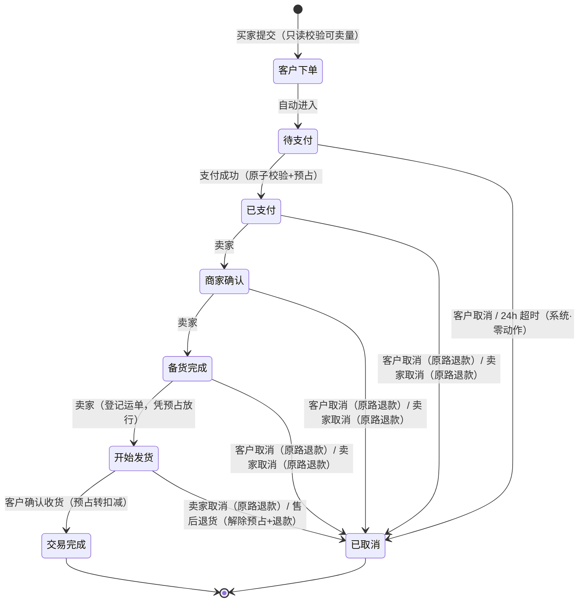

# 需求规格说明书（挑战需求C）

> 版本 V2.1 · 基线：《需求规格说明书（挑战需求B）》V1.5 · 编制：第 13 组 · 日期：2026-11-20

## 1 引言

### 1.1 编写目的

本文档定义挑战需求 C（支付升级、配送升级、售后服务升级）落地后的系统需求规格。C 包**叠加**于基线 MVP + 挑战 A + 挑战 B 之上：B 包 V1.5 的全部条款继续有效，**除非本文档显式废止或改写**。所有对 B 包条款的废止、改写均经业务方 3 轮澄清批复确认，留痕见 5.1 / 5.3。

### 1.2 项目范围

| 范围 | 内容 |
| --- | --- |
| 上位基线 | 基线 MVP + 挑战 A（收藏前置形态）+ 挑战 B（购物车 / 订单 / 限时活动价）全部沿用 |
| 升级需求 C.1（支付） | 订单线上支付；支持银行卡、信用卡、支付宝、微信支付 **4 渠道全支持**；订单流程增加「待支付、已支付」2 个状态 |
| 升级需求 C.2（配送） | 订单商品快递配送；物流服务商清单由卖家维护；客户可配置多个收货地址（含默认地址）；客户可查询发货后的物流状态（单号 + 跟踪信息） |
| 升级需求 C.3（售后） | 客户可对订单中**某件商品**发起售后申请（标题、描述、图片）；卖家线下协商；结果含退货、退款、换货 |
| 个性化需求（本包自加，横向） | **买家评价**：交易完成后按明细单件评价（评分/文字/图片），商品页聚合展示——平行单据模式，不改状态机、库存、支付任何现行条款 |
| 本包废止的 B 包约束 | ① 无在线支付 → 废止（线上支付 4 渠道）；② 订单无地址字段 → 废止（地址簿 + 订单地址快照）；③ 无退款/售后 → 废止（售后模块）；④ 无超时自动流转 → 废止（**新增待支付超时 24h 自动取消**，为全系统唯一超时机制） |
| 本包保留的 B 包约束 | 下单不锁库存、单卖家自营、商品 `在售 / 已下架` 两态、**无主动通知**（客户自行查订单页）、限时活动价整套规则 |
| 不在本包范围 | 运费及其定价、维修、部分退款、发货前售后入口、真实支付网关 / 真实物流接口对接、签收自动确认收货、主动通知（站内信/短信）、数据迁移 |

> **单卖家前提延续**：系统为单卖家自营，无多商家、无跨商家拆单（A-CL-B46 沿用）。

### 1.3 术语与缩写

| 术语 | 含义 |
| --- | --- |
| **账面库存** | 商品库存的唯一账面数，非负整数约束不变（CA-B2 沿用）。**预占不改变账面数**，账面数只在成交时原子扣减 |
| **预占量** | 某商品所有「已支付且未成交」订单的明细数量之和；是**占用标记维度**，不是第二个库存数；登记与释放均不触碰账面数 |
| **可卖量** | `账面库存 − 预占量`；支付校验与商品页展示的依据 |
| 待支付 | 下单成功后自动进入的支付等待状态；**24h 超时自动取消**（全系统唯一超时机制） |
| 确认收货 | 买家的**动作**（手动点击），触发订单进入「交易完成」——不是状态名 |
| 原路退回 | 退款退回原支付渠道；金额为订单明细**下单快照价**全额 |
| 售后单 | 挂在订单**明细**上的平行单据（申请 → 协商 → 结果），有自己的生命周期，**不改写订单状态** |
| 地址快照 | 下单时写入订单的收货地址副本；后续地址簿变更不回写 |
| 运单号 | 卖家发货时登记的物流单号；一个订单一个运单，不拆包裹 |
| 一致性要求 | 业务方两条可靠性要求：「支付 / 订单 / 库存一致」「退款与支付渠道对账一致」（A-CL-C17） |

### 1.4 参考文献

| 序号 | 类别 | 名称 |
| --- | --- | --- |
| 1 | 标准 | IEEE Std 830-1998 |
| 2 | 标准 | ISO/IEC/IEEE 29148:2018 |
| 3 | 上位文档 | 《需求规格说明书（挑战需求B）》V1.5 |
| 4 | 澄清记录 | 《澄清提问清单（挑战需求C）.md》（38 问 / 3 轮批复，A-CL-C01~C35） |
| 5 | 变更单 | CR-C01（C 包影响面与 4 条约束废止）/ CR-C02（个性化需求「买家评价」），留痕见 5.3 |

---

## 2 总体描述

### 2.1 产品视角

在基线 + A + B 之上进行三大升级，**交易链路从「线下钱货两清」演进为「线上支付 + 快递配送 + 售后兜底」**：

1. **支付介入交易链路**：下单后进入「待支付」，支付成功即进入「已支付」并**原子预占库存**；「交易完成」由**客户确认收货**触发（原为卖家手动标记）。
2. **库存模型升级为「账面 + 预占」两层**：账面库存仍是唯一库存数、非负约束不变；预占是已支付订单的占用标记，不改变账面数；**成交才扣**（扣减仍只发生在交易完成）。业务方批复确认：预占为团队引入的机制，方向守住「避免超卖与资损」，须与「成交才扣」在规格中区分清楚（A-CL-C03，见 RA-C2）。
3. **硬约束升级**：从 B 包「避免超卖」升级为「**避免超卖与资损**」——钱已收的订单必须可交付或可退款（A-CL-C04）。
4. **地址与配送**：订单增加地址快照；一单一运单；物流状态（单号 + 跟踪信息）客户可查；**物流签收不自动推进状态**，确认收货只能由客户手动触发。
5. **售后为平行单据**：售后按明细单件发起，订单状态机不受售后改写；退款不新增订单状态、不回退（订单停在「交易完成」，退款记录在售后单上）。
6. **个性化需求（横向自加）：买家评价**——交易完成后按明细单件评价，商品页聚合展示；复用售后单的「平行单据」架构模式，状态机 / 库存 / 支付现行条款零改动（FR-C21~C23）。

**一句话概括本版本的设计主张**：*钱在支付时收（收钱即预占），货在发货时出，账在确认收货时结* —— 收钱必有货（预占保证）或有退款（取消/售后兜底），拦截与兜底共同守住「不超卖、不资损」。

### 2.2 用户特征

| 角色 | 描述 |
| --- | --- |
| 注册买家 | 登录后加购、收藏、下单；下单后**支付**（待支付 24h 内）；可配置多个收货地址并选默认；「开始发货」前可取消（已支付段取消即原路退款）；可查询发货后物流；**确认收货**（触发交易完成）；「开始发货」起可发起售后；全程自助查询（无通知） |
| 卖家（唯一账号） | 沿用 B 包全部职责（商品管理、手动推进商家确认/备货完成/开始发货）；新增：维护物流服务商清单、登记运单号、处理售后申请（线下协商、录入结果、寄回件确认）；「交易完成」前可取消任意订单（已支付订单取消须原路退款） |
| 匿名访客 / 平台管理员 | 沿用 B 包口径（访客不可交易；无管理员角色） |

### 2.3 假设与依赖

- 继承基线 + A 包 + B 包全部假设与依赖（Docker、Maven、MySQL/SQLite、JUnit、Selenium、禅道）。
- **支付与物流均为需求边界内的功能定义，真实网关/接口对接属技术实现**：4 渠道全支持为需求口径；实现方式（沙箱 / 界面模拟）由技术方案决定，不影响本规格（A-CL-C13）。
- 物流「跟踪信息」的数据来源（外部接口同步 / 卖家手录）未写死，属实现层；需求只要求客户可查**单号 + 跟踪信息**（A-CL-C14）。
- 数据迁移不在需求范围：B 包存量订单（无支付/地址/物流字段）的展示与处置不在本包约束内（A-CL-C02）。
- 无运费：需求未定义运费，本版本支付金额 = 订单明细快照价合计（A-CL-C26）。
- 无主动通知（沿用 B 包）：支付结果看支付页，发货/物流/售后进展由客户自行查询（A-CL-C29）。

### 2.4 需求约束（CA-C）

| 编号 | 约束 | 内容 |
| --- | --- | --- |
| CA-C1 | 非负库存（沿用） | 账面库存为非负整数；一切扣减使用条件更新（影响行数 0 即不足），任何路径不得出现负库存 |
| CA-C2 | 不超卖、不资损 | **硬约束升级版**：不得超卖（沿用 CA-B3 骨架）；**已收款的订单必须可交付或可全额原路退款**——支付成功即预占，预占不足则支付不成功（收不到钱）；已支付不可交付的路径一律以自动原路退款收尾 |
| CA-C3 | 预占不扣账 | 预占是占用标记，不改变账面库存数；可卖量 = 账面 − 预占；账面数**只在交易完成时原子扣减**（成交才扣，沿用 CA-B 骨架）；预占释放的三条路径见 RA-C2 |
| CA-C4 | 7 态 + 已取消 | 订单状态共 7 个推进态（客户下单 / 待支付 / 已支付 / 商家确认 / 备货完成 / 开始发货 / 交易完成）+ 独立终态「已取消」；「客户确认收货」是触发交易完成的**动作**而非状态；状态机严格按序、不可跳过、不可回退（非法流转拦截）；订单不可删除 |
| CA-C5 | 唯一超时机制 | 全系统唯一的自动流转 = **待支付 24h 超时自动取消**；除此之外无任何自动流转（无签收自动完成、无确认收货超时）——业务方明确接受「开始发货」长期停留（A-CL-C30，出路见 RA-C5） |
| CA-C6 | 已支付商品保护 | 商品存在「已支付且未成交」订单期间，**禁止手动改库存为 0、禁止手动下架**（守住不资损）；成交扣减导致的自动下架不受此限（A-CL-C27） |
| CA-C7 | 售后不占状态机 | 售后单按明细单件挂载、独立生命周期；售后**不新增订单状态、不回退**——唯一例外：开始发货态售后全额退款（退货退款 / 仅退款）→ 订单转「已取消」（进入终态而非回退，业务方批复 A-CL-C23）；交易完成后订单不可取消但可售后（两条退出路径互不干扰） |
| CA-C8 | 地址快照 | 收货地址写入订单快照；下单后不可修改地址；修改/删除默认地址不影响历史订单显示（A-CL-C32） |
| CA-C9 | 支付幂等与对账 | 同一订单同时仅一笔有效支付（支付单幂等）；重复回调幂等处理；对账发现不一致以支付渠道记录为准修正订单状态（A-CL-C31） |
| CA-C10 | 口径不混用（扩展） | B 包 CA-B9 扩展为三口径：**账面库存**（非负约束对象）、**预占量**（支付校验与可卖量计算）、**已发货量**（降级为纯展示——发货凭预占放行，不再作校验输入）；三者不得互相替代 |

### 2.5 编号与标注约定

- 功能需求 `FR-Cxx`；硬约束 `CA-Cxx`；业务规则 `RA-Cx`；验收场景 `AB-Cxx`；明确不做 `OUT-Cxx`；团队决策 `D-Cxx`。
- 业务方批复统一登记为 `A-CL-Cxx`（3 轮澄清 + 13 条决策批复，见 5.1）。
- 跨包引用保留原编号（`A-CL-Bxx` / `CA-Bx` / `FR-Bxx` 等）；被 C 包改写的 B 包条款在 5.6 追溯矩阵中标注「改写 / 废止 / 沿用」。
- 每条团队决策标注 `【D-Cxx 团队决策】`，附理由与收回成本，不冒充业务方裁定。

---

## 3 具体需求

### 3.1 功能需求（FR-C01~FR-C20）

#### 3.1.1 支付模块

| 编号 | 名称 | 优先级 | 描述 |
| --- | --- | --- | --- |
| FR-C01 | 提交订单进入待支付 | 高 | 买家提交订单（登录、**只读校验可卖量 ≥ 明细数量**，不锁不预占）后**自动进入「待支付」**；订单金额 = 明细快照价合计（发布价或活动价，沿用 B 包快照与适用价口径），无运费；全站无议价入口 |
| FR-C02 | 发起支付 | 高 | 买家在待支付状态下发起支付，选择 4 渠道之一（银行卡 / 信用卡 / 支付宝 / 微信）；**同一订单同时仅一笔有效支付**（重复发起被拦截，CA-C9）；支付过程中订单保持待支付，卖家无推进动作可做 |
| FR-C03 | 支付成功与预占 | 高 | 支付成功瞬间**原子执行「校验 + 预占」**：可卖量 ≥ 明细数量则登记预占、订单转「已支付」，并记录支付渠道与支付时间；可卖量不足则支付不成功（不收钱），订单停留在待支付——**收不到钱即无资损**（CA-C2）；若渠道已扣款而预占校验失败（回调型实现），**立即全额原路退款**并停留待支付（NFR-C02 对账一致）；支付失败 / 放弃支付 → 停留待支付，可重试 |
| FR-C04 | 待支付超时自动取消 | 高 | 待支付超过 **24h** → 系统自动取消，订单转「已取消」；**零库存动作、零资金动作**（未支付未预占）；全系统唯一超时机制（CA-C5） |
| FR-C05 | 支付对账 | 中 | 支付记录、订单状态、库存预占三方一致（CA-C9）；重复回调幂等处理（不产生二次预占 / 二次退款）；对账发现不一致以**支付渠道记录为准**修正订单状态 |

#### 3.1.2 订单取消与退款

| 编号 | 名称 | 优先级 | 描述 |
| --- | --- | --- | --- |
| FR-C06 | 取消窗口（三方） | 高 | **客户**可取消：待支付（无资金动作）/ 已支付 / 商家确认 / 备货完成（**已支付段取消即原路退款**）；「开始发货」起客户不可取消（与 B 包口径对齐）。**卖家**可取消：交易完成前任意状态，含已支付订单（取消即原路退款）。**系统**可取消：仅待支付 24h 超时。取消为整单、不可逆、需二次确认、转「已取消」；取消不记录原因（沿用 B 包）；退款全额原路退回 |
| FR-C07 | 原路退款 | 高 | 一切退款**全额、原渠道退回**（取消退款 / 售后退款同一口径）；退款金额 = 下单快照价（活动价单退活动价，A-CL-C26 / AB-C14）；退款动作幂等，与支付渠道对账一致（CA-C9） |

#### 3.1.3 地址与配送

| 编号 | 名称 | 优先级 | 描述 |
| --- | --- | --- | --- |
| FR-C08 | 地址簿管理 | 中 | 买家可新增 / 编辑 / 删除收货地址（姓名、电话、省市区、详细地址），可设一个默认地址；地址数量上限 20（【D-C05 团队决策】） |
| FR-C09 | 下单选择地址 | 高 | 下单时**默认地址自动带入、可切换选择**（业务方明确，A-CL-C15）；所选地址**写入订单快照**；下单后不可修改地址；修改默认地址不影响任何历史订单（CA-C8） |
| FR-C10 | 发货登记运单 | 中 | 卖家点「开始发货」时登记**物流服务商 + 运单号**（物流商清单卖家维护，数量不限）；**一个订单一个运单**，不拆包裹（A-CL-C35）；未登记运单号不允许进入开始发货（运单号与开始发货绑定登记，D-C08） |
| FR-C11 | 物流状态查询 | 中 | 客户可查询发货后订单的物流状态：**运单号 + 跟踪信息**（跟踪信息以状态条目呈现：揽收 / 运输中 / 派送 / 已签收 等枚举 + 时间）；数据来源属实现层（手录或接口）；**物流「已签收」不自动推进订单状态**——确认收货只能由客户手动触发（CA-C5） |

#### 3.1.4 售后模块

| 编号 | 名称 | 优先级 | 描述 |
| --- | --- | --- | --- |
| FR-C12 | 发起售后申请 | 高 | **售后窗口自「开始发货」起**：开始发货、交易完成两态可发起；发货前不设售后入口（退款走取消，A-CL-C21 / C22）；按**订单明细单件**发起（一单三件只退一件，其余不受影响）；申请单字段：标题（必填）、问题描述（必填）、图片（0~3 张，≤5MB/张）【D-C06 团队决策】；同一明细同时仅 1 个进行中售后单，结果为驳回后可重新发起（A-CL-C24） |
| FR-C13 | 协商与结果录入 | 中 | 卖家收到申请后**线下与客户协商**；系统只记录申请与最终结果，不记录协商过程；结果由**卖家录入**售后单；客户在订单页自助查看进展（无通知，沿用） |
| FR-C14 | 售后结果枚举 | 高 | 结果仅四种：**退货退款 / 仅退款 / 换货 / 驳回**；不做维修、部分退款（OUT-C01）；驳回为协商失败的兜底出口；结果写入售后单后售后单闭环 |
| FR-C15 | 退货退款执行 | 高 | **交易完成态**：卖家在售后单确认收到退货 → **同步回补账面库存 + 原路退款**；订单保持「交易完成」；回补的商品若此前已因库存 0 自动下架，**不自动恢复在售**，须卖家手动上架（沿用 B 包口径）；**开始发货态**：卖家确认收到退回件 → **解除预占 + 原路退款**，订单转「已取消」（未成交无账可扣，A-CL-C23） |
| FR-C16 | 仅退款与换货 | 中 | **仅退款**（不退货）：直接原路退款；**交易完成态**订单保持「交易完成」，**开始发货态**同步解除预占、订单转「已取消」（与退货退款同口径，CA-C7 例外）；**换货**：客户寄回旧件、卖家寄出新件（各记运单号），**1 换 1、账面库存不动**（回补与扣减相互抵消，实物线下处理）【D-C07】；换货时商品已下架或可卖量为 0 → 售后结果**自动转为仅退款**兜底，无需客户重新申请（不做"换其他商品"，OUT-C01）【D-C07】 |

#### 3.1.5 订单状态机升级与库存保护

| 编号 | 名称 | 优先级 | 描述 |
| --- | --- | --- | --- |
| FR-C17 | 7 态状态机 | 高 | 状态机改写为 7 推进态 + 已取消（RA-C1）；触发者三方：**买家**（下单 / 支付 / 确认收货 / 取消）、**卖家**（商家确认 / 备货完成 / 开始发货 / 取消 / 售后处理）、**系统**（待支付 24h 超时取消）——B 包「推进全部由卖家手动」正式废止；非法流转一律拦截并提示（沿用） |
| FR-C18 | 交易完成与扣减 | 高 | 「开始发货」→「交易完成」由**客户确认收货**触发；触发瞬间**预占转正式扣减**：按明细数量原子扣减账面库存（条件更新，并发兜底沿用 CA-B2）；扣减后库存为 0 → 商品自动下架（沿用）；交易完成后不可取消、不可回退（CA-C7），退出路径只剩售后 |
| FR-C19 | 发货凭预占放行 | 高 | 「开始发货」不再做 B 包式容量校验（预占已在支付时保证可交付）；校验仅确认该订单预占有效（未被取消 / 退款释放）；**B 包「已发货量」口径降级为纯展示**（CA-C10） |
| FR-C20 | 已支付商品保护 | 高 | 商品存在「已支付且未成交」订单期间：禁止手动改库存为 0、禁止手动下架（CA-C6）；此为 B 包 A-CL-B64「在途时禁止」的扩展；成交扣减导致的自动下架不受限 |

#### 3.1.6 个性化需求：买家评价（横向，本包自加）

| 编号 | 名称 | 优先级 | 描述 |
| --- | --- | --- | --- |
| FR-C21 | 发起评价 | 中 | 仅「交易完成」订单可评价；**按明细单件、每明细一次**（与售后粒度对齐）；待支付 / 已取消 / 发货前各态无评价入口。字段：评分 1~5 星（必填）、文字 ≤200 字（选填）、图片 0~3 张且 ≤5MB/张（沿用 D-C06 图片口径）。提交后**不可修改、不可删除**（终态纪律，D-C13）；**退货退款 / 仅退款已闭环的明细不可评价**（钱已退回，视同该件未成交，D-C12）；已提交的评价不因后续售后撤回 |
| FR-C22 | 评价展示 | 中 | 商品页展示**聚合评分**（平均分 + 评价数，实时计算的只读值，不落库存口径）与评价列表（评分 / 文字 / 图 / 时间）；买家昵称脱敏显示（D-C14）；未登录访客可看不可发（沿用登录隔离）；商品已下架 → 详情不可打开、评价随详情不可见（沿用 B 包口径，无新规则） |
| FR-C23 | 评价约束（横向声明） | 中 | 评价为**平行单据**：不改写订单状态、不触碰库存与支付（复用售后单架构模式，第二次应用）；全程无通知；卖家回复、追加 / 修改评价、好评返现均不做（OUT-C01） |

### 3.1.7 沿用声明

B 包 FR-B07（收藏）/ FR-B08（购物车）/ FR-B12（商品两态）/ FR-B15（限时活动价）**全部沿用**，仅两处衔接：① 活动价订单退款按快照价全额退（AB-C14）；② 换货兜底转仅退款时同样按快照价（FR-C16）。

### 3.2 业务规则

#### RA-C1 订单状态机（7 态 + 已取消）

| # | 规则 |
| --- | --- |
| 1 | 严格按序、不可跳过、不可回退；非法流转拦截并提示（沿用） |
| 2 | 「已取消」为独立终态，与「交易完成」互斥；文案不区分取消方（沿用） |
| 3 | 触发者三方：买家（下单/支付/确认收货/取消）、卖家（确认/备货/发货/取消/售后处理）、系统（仅待支付 24h 超时） |
| 4 | 任何取消在已支付段均伴随**全额原路退款**；待支付段取消零资金动作 |
| 5 | 界面字段在 B 包 5 项基础上扩展：**支付渠道、支付时间、收货地址快照、运单号**；状态时间戳仅供排查（沿用） |

#### RA-C2 库存与预占规则（核心——「预占」与「成交才扣」的关系）

> 业务方批复（A-CL-C03）：库存是「成交（交易完成）时才扣」，没有「预占」概念；预占为团队引入的机制，须与「成交才扣」区分清楚、不得自相矛盾。本条即该区分的规格化表述。

| # | 规则 |
| --- | --- |
| 1 | **账面库存是唯一库存数**：非负整数约束（CA-C1）、条件更新扣减（影响行数 0 即不足）全部沿用 CA-B2，本包不改 |
| 2 | **预占不扣账**：预占量 = 所有「已支付且未成交」订单的明细数量之和；它是支付成功瞬间登记的**占用标记**，登记时账面数不变 |
| 3 | **可卖量 = 账面库存 − 预占量**：支付成功的「校验 + 预占」原子执行（可卖量不足 → 支付不成功、不收钱）；下单只读校验同样以可卖量为对象（不锁不预占） |
| 4 | **成交才扣**：账面数只在「客户确认收货 → 交易完成」瞬间原子扣减（预占转扣减）；这是账面数唯一的减少路径 |
| 5 | **预占的三条释放路径**：① 取消 / 待支付超时（未成交，直接解除）；② 开始发货态售后退货（解除预占 + 订单转已取消）；③ 交易完成（转为正式扣减）。前两条不触碰账面数 |
| 6 | **三口径不混用**（CA-C10）：账面库存（非负约束）/ 预占量（支付校验 + 可卖量）/ 已发货量（降级为展示）；B 包「发货前容量校验」由预占机制**替代**——发货凭预占放行 |
| 7 | 商品页展示升级：`库存 / 可卖量`，可卖量 ≤ 0 或不足时提示缺货风险（沿用 B 包「库存 / 在途」预警思路，在途量口径并入预占展示） |
| 8 | 已支付商品保护（CA-C6）：存在预占期间禁止手动改 0 / 手动下架；成交扣减自动下架不受限 |

#### RA-C3 支付与退款规则

| # | 规则 |
| --- | --- |
| 1 | 支付单幂等：同一订单同时仅一笔有效支付；重复回调不产生二次预占、二次退款（CA-C9） |
| 2 | 对账裁决：支付 / 订单 / 库存预占三方一致；退款与渠道对账一致；不一致以**渠道记录为准**修正（A-CL-C31） |
| 3 | 退款全额、原渠道、按下单快照价；退款路径仅两条：取消退款（发货前）/ 售后退款（发货后） |
| 4 | 支付失败 / 放弃 → 停留待支付可重试；24h 超时自动取消（零动作） |

#### RA-C4 售后单生命周期规则

| # | 规则 |
| --- | --- |
| 1 | 状态：`申请中 → 协商中 → 已闭环（四种结果之一）`；闭环后不可再改结果 |
| 2 | 挂载于订单明细、单件发起；同一明细同时仅 1 个进行中售后单；驳回后可重新发起（A-CL-C24） |
| 3 | 售后不改写订单状态：退款记录在售后单上，订单停在原状态（CA-C7） |
| 4 | 无通知：进展由客户在订单页自助查看（A-CL-C29） |
| 5 | 结果执行对照：退货退款（FR-C15 两态路径）/ 仅退款（原路退款）/ 换货（FR-C16）/ 驳回（无任何资金与库存动作） |

#### RA-C5 长期挂单兜底规则（「开始发货」停留的出路）

| # | 规则 |
| --- | --- |
| 1 | 「开始发货」无自动流转（CA-C5）；订单停留多久都不会超卖或负库存（预占不扣账）——**定性为业务效率问题，非一致性问题**（业务方明确接受，A-CL-C30） |
| 2 | 卖家出路：补货后推进 / 取消订单（原路退款） |
| 3 | 买家出路：发起售后（退货退款 → 解除预占 + 退款 + 订单转已取消） |
| 4 | 系统出路：无（不自动取消、不自动退款、不自动签收） |
| 5 | 与 B 包 RA-B7（卡单只亮灯不动手）同构：可见性提示 + 各方出口，系统不做第三条路 |

### 3.3 非功能需求（继承基线 / A / B 包全部 NFR，新增 NFR-C）

| 编号 | 名称 | 描述 |
| --- | --- | --- |
| NFR-C01 | 支付幂等性 | 同一订单同时仅一笔有效支付；重复支付请求、重复回调均幂等（无二次预占 / 二次退款） |
| NFR-C02 | 三方一致性 | 支付记录、订单状态、库存预占三方一致；退款与支付渠道对账一致（业务方可靠性要求，A-CL-C17） |
| NFR-C03 | 时间基准 | 支付时间、待支付 24h 计时、活动价边界一律以**服务端时间**为准（沿用 A-CL-B 口径） |
| NFR-C04 | 原子性 | 「校验 + 预占」「预占转扣减」「回补 + 退款」均为原子操作；并发下条件更新保证不超卖、不双扣、不双退 |
| NFR-C05 | 性能 | 关键交易接口（发起支付 / 支付成功回调 / 确认收货 / 取消退款）**P95 < 500ms**（对齐基线 NFR-01 口径）；预占量与可卖量的实时计算不引入额外可感知延迟；模拟支付渠道响应延迟可控（≤ 1s），以支撑超时取消与对账测试 |
| NFR-C06 | 后台任务及时性 | 两类后台定时任务的**调度周期 ≤ 5 分钟**：① 待支付 24h 超时取消——订单到期后一个调度周期内完成取消；② 支付对账——回调丢失 / 渠道记录与订单不一致的修正延迟不超过一个调度周期【D-C11 团队决策】 |

### 3.4 外部接口

| 接口 | 说明 |
| --- | --- |
| 支付渠道（4 个） | 银行卡 / 信用卡 / 支付宝 / 微信；需求层面要求 4 渠道全支持；实现方式（沙箱 / 模拟界面 + 渠道记录）属技术层，接口必须能产出**可对账的渠道记录**（NFR-C02 的前提） |
| 物流状态来源 | 运单号 + 跟踪信息条目；来源（接口同步 / 卖家手录）属实现层；展示口径统一为枚举状态 + 时间条目 |

### 3.5 数据需求

| 数据实体 | 字段 |
| --- | --- |
| 订单表（扩展） | B 包 5 项界面字段 + **支付渠道、支付时间、收货地址快照（姓名/电话/省市区/详细地址）、运单号、物流服务商**；预占量不落字段（由「已支付且未成交」订单明细实时计算） |
| 支付记录表（新增） | 支付单号、订单号、渠道、金额（快照合计）、状态、渠道流水号、时间 |
| 退款记录表（新增） | 退款单号、关联支付单号 / 售后单号、金额、渠道、状态、时间 |
| 地址簿表（新增） | 买家账号、姓名、电话、省市区、详细地址、是否默认（每账号至多 1 个默认） |
| 售后单表（新增） | 售后单号、订单明细 ID、标题、描述、图片（0~3）、状态（申请中/协商中/已闭环）、结果（退货退款/仅退款/换货/驳回）、结果时间、退货运单号、换货运单号 |
| 评价表（新增） | 评价号、订单明细 ID、买家账号、评分（1~5）、文字（≤200 字）、图片（0~3）、提交时间；商品页聚合评分为实时计算值，不落库 |
| 商品表 | 不新增字段（B 包 3 个活动价字段沿用；预占为计算维度不落库） |

---

## 4 验收准则

### 4.1 通用前提

- 沿用 B 包 4.1 全部通用前提（登录隔离、商品两态、快照口径等）。
- 新增前提：支付 / 物流以**可对账的渠道记录**模拟存在；时间以服务端为准；无通知环境下所有进展客户可在订单页自助查得。

### 4.2 关键验收场景（AB-C01~AB-C14）

| 编号 | 场景 |
| --- | --- |
| AB-C01 | **双支付竞态（不资损）**：库存 1，买家 A、B 先后下单；A 支付成功（预占 1，账面仍 1，可卖量 0）→ B 发起支付：可卖量不足，**支付不成功、不收钱**；账面库存 1、不为负 |
| AB-C02 | **待支付超时**：下单后不支付 → 24h 后系统自动转「已取消」；无资金动作、无预占登记、账面不变 |
| AB-C03 | **预占不扣账**：账面 5，A 下单 1 件并支付成功 → 账面 5、预占 1、可卖量 4；商品页显示 `库存 5 / 可卖 4` |
| AB-C04 | **已支付商品保护**：A 支付成功后，卖家尝试改库存为 0 / 手动下架 → 均被拦截并提示「存在已支付订单」 |
| AB-C05 | **已支付取消退款**：A 在已支付态取消 → 全额快照价原路退回、预占解除、订单转「已取消」 |
| AB-C06 | **取消窗口边界**：开始发货态客户无取消入口；卖家仍可取消（原路退款）；交易完成后客户无取消入口、卖家无取消入口 |
| AB-C07 | **确认收货扣减**：开始发货（账面 5、预占 1、可卖 4）→ 客户确认收货 → 账面 4、预占 0、可卖 4；账面若降至 0 → 商品自动下架 |
| AB-C08 | **售后窗口边界**：待支付 / 已支付 / 商家确认 / 备货完成四态均**无售后入口**（退款走取消）；开始发货、交易完成两态有入口 |
| AB-C09 | **交易完成退货退款**：确认收货（账面 4）→ 发起售后退货退款 → 卖家确认收到退货 → 账面回补至 5 + 原路退款；订单保持「交易完成」；若商品此前已自动下架则保持下架、须手动上架 |
| AB-C10 | **开始发货态退货**：开始发货（预占 1）→ 售后退货退款 → 卖家确认收到退回件 → **解除预占**（账面不变）+ 原路退款 + 订单转「已取消」 |
| AB-C11 | **换货与兜底**：换货 1 换 1 账面数不变，寄回 / 寄出各记运单号；换货时商品已下架或可卖量 0 → 结果自动转「仅退款」，客户无需重新申请 |
| AB-C12 | **地址快照**：A 用地址 X 下单 → 修改默认地址为 Y → 历史订单仍显示 X；下单后无修改地址入口 |
| AB-C13 | **支付幂等**：同一订单重复回调 → 仅一次预占、一条支付记录；对账任务发现渠道与订单不一致 → 以渠道记录为准修正 |
| AB-C14 | **活动价退款**：限时活动价 80 元下单支付 → 活动结束后取消（已支付段）→ **退 80**（快照价），非原价 100 |
| AB-C15 | **开始发货态仅退款**：开始发货（预占 1）→ 售后仅退款 → 全额原路退回 + 解除预占 + 订单转「已取消」；无库存账面动作（未成交无账可扣） |
| AB-C16 | **评价闭环**：确认收货 → 交易完成，明细出现评价入口 → 提交 4 星 + 文字 + 2 图 → 商品页聚合评分与评价数更新；再进明细显示「已评价」、无再次入口；评价提交后无修改 / 删除入口 |
| AB-C17 | **评价与售后交叉**：明细先提交差评 → 后走退货退款并闭环（钱已退）→ **评价保留、计入商品聚合**；另一明细仅退款闭环 → 该明细**无评价入口**（钱已退，视同未成交） |
| AB-C18 | **评价边界**：待支付 / 已取消 / 发货前各态均无评价入口；未登录访客可看商品页评价但不可提交；商品下架后详情打不开、评价不可见（沿用） |

### 4.3 非功能验收

| 项 | 验收方式 |
| --- | --- |
| 支付幂等（NFR-C01） | 重复发起支付 / 重复回调脚本验证：预占、支付记录、退款记录均无重复 |
| 三方一致性（NFR-C02） | 构造渠道记录与订单不一致的用例：对账修正后以渠道为准 |
| 原子性（NFR-C04） | 并发双支付、并发确认收货 + 取消竞态脚本：库存不为负、不双扣、不双退 |
| 性能（NFR-C05） | 50 并发混合场景（下单 / 支付 / 确认收货 / 取消）压测：关键交易接口 P95 < 500ms，且全程零超卖、零双扣、零双退——性能与正确性合并度量 |
| 及时性（NFR-C06） | 构造到期待支付订单与渠道记录不一致用例：验证超时取消与对账修正均在到期 / 发现后 5 分钟内完成 |

---

## 5 附录

### 5.1 业务方裁定（A-CL-C01~C35）

| 编号 | 裁定 |
| --- | --- |
| A-CL-C01 | 交付范围：C 叠加于 A/B，B 包未被废止条款全部沿用 |
| A-CL-C02 | 存量订单迁移不在需求范围 |
| A-CL-C03 | 硬约束升级为「避免超卖与资损」；拦截点前移方向获批，边界规则由团队补全；预占须与「成交才扣」在规格中区分清楚（见 RA-C2） |
| A-CL-C04 | 拦截点方案按「不超卖、不资损」两条校验（授权模式同 B 包 Q-B34） |
| A-CL-C05~C09 | 5 条 B 包约束处置：在线支付 / 地址 / 售后 / 自动流转（仅待支付 24h 一处）**废止**；主动通知**保留** |
| A-CL-C10 | 状态机 7 态定稿：「客户下单」「待支付」为两个独立状态；「客户确认收货」是动作非状态名；「已取消」为独立终态 |
| A-CL-C11 | 客户确认收货 = 买家手动点击；无物流签收自动触发、无确认收货超时 |
| A-CL-C12 | 已支付后取消 = 原路退款；商家取消止于交易完成前 |
| A-CL-C13 | 支付 4 渠道全支持（非"至少两家"）；真实对接属技术实现 |
| A-CL-C14 | 物流要求 = 单号 + 跟踪信息；数据来源属实现层 |
| A-CL-C15 | 下单默认地址自动带入、可切换选择（明确） |
| A-CL-C16 | 售后窗口未绑状态 → 团队补全（批复见 C21/C22） |
| A-CL-C17 | 一致性要求两条：「支付/订单/库存一致」「退款与渠道对账一致」（NFR-C02 依据） |
| A-CL-C18 | 支付异常兜底规则由团队补全（批复见 C31） |
| A-CL-C19 | 已支付商品保护方向获批，规则由团队补进规格（批复见 C27） |
| A-CL-C20 | 售后粒度 = 按明细单件发起；退款不新增状态、不回退；交易完成可售后（另一条路径） |
| A-CL-C21 | **售后窗口自「开始发货」起**；发货前退款统一走取消（已支付段取消即原路退款）——口径与需求一致 |
| A-CL-C22 | 发货前不设「售后=仅退款」入口（与取消是同一件事） |
| A-CL-C23 | 两条售后终止路径获批：未成交转「已取消」（解除预占）/ 已成交保持「交易完成」（回补库存） |
| A-CL-C24 | 售后单规则获批：每明细 1 个进行中、驳回后可重新发起 |
| A-CL-C25 | 换货 = 寄回旧件、寄出新件（常见做法）；库存处理由团队定（批复见 D-C07）；下架/库存 0 处理由团队补（批复见 D-C07） |
| A-CL-C26 | 无运费：支付金额 = 明细快照价合计 |
| A-CL-C27 | 已支付（预占）期间禁止改 0 / 下架获批 |
| A-CL-C28 | 无超时自动确认收货可接受；「开始发货」长期挂单的库存占用须在规格写清（批复见 RA-C5） |
| A-CL-C29 | 无主动通知获批 |
| A-CL-C30 | 长期停留定性为业务效率问题，可接受 |
| A-CL-C31 | 支付异常兜底（幂等 / 渠道记录为准修正）获批 |
| A-CL-C32 | 地址快照、下单后不可改、改默认不影响历史订单获批 |
| A-CL-C33 | 已支付后 / 开始发货前客户可取消（原路退款）；开始发货起不可取消获批 |
| A-CL-C34 | 回补时点 = 卖家确认收到退货获批 |
| A-CL-C35 | 一单一运单、不拆包裹获批 |

### 5.2 团队决策项（D-C）

| 编号 | 决策 | 理由 | 收回成本 |
| --- | --- | --- | --- |
| D-C01 | 支付成功即预占（方案 C） | 「校验+预占」原子执行使支付被拒即收不到钱，同时满足不超卖与不资损；平移 B 包三道关卡会留下"付了钱才发现没货"的资损窟窿 | 若取消预占回退为发货前容量校验：改 RA-C2 第 3/6 条 + FR-C03/FR-C19，状态机不动 |
| D-C02 | 下单只读校验对象 = 可卖量（账面−预占） | 只校验账面会让买家下单必然失败的预占商品；可卖量校验更诚实 | 仅改 FR-C01 一处校验对象 |
| D-C03 | 待支付 24h 超时（数值） | 业务方定"超时自动取消"未定时长；24h 为电商惯例 | 改 FR-C04 一个常量 |
| D-C04 | 「客户下单 → 待支付」自动流转 | 两状态独立但中间无任何动作，自动进入是唯一合理解释；「客户下单」态承担**提交成功确认**语义（展示订单已受理、引导去支付），随后自动进入支付等待；业务方确认唯一超时在待支付 | 若改为人工触发：改 RA-C1 图与 FR-C01 |
| D-C10 | 售后发起不设时限 | 业务方未定窗口时限；「开始发货起可发起」已是边界，时限属额外收紧——暂不设；滥用风险接受（同一明细进行中唯一已防并发滥用，驳回可重发保留客户救济通道，与 B 包收藏无上限同风格） | 若日后要求时限（如签收后 7 天）：改 FR-C12 一条校验 |
| D-C11 | 后台任务调度周期 ≤ 5 分钟 | 业务方定了"24h 超时取消"与"对账一致"但未定执行方式；5 分钟为课程项目合理量级——既保证客户感知及时（超时后能尽快重新下单），又不引入高频空转 | 若要求更实时：改 NFR-C06 常量或改推送式实现（架构变化，需重新评估） |
| D-C12 | 退款闭环明细不可评价；已提交评价不撤回 | 钱已原路退回 = 该件未成交，无评价资格；但"先差评后退货"现实中合理，撤回已提交评价会引入删除语义与聚合重算复杂度——保留计入 | 若业务方要求"退货即删评"：改 FR-C21 一条 + 聚合重算逻辑 |
| D-C13 | 评价一次性、不可修改删除 | 与「订单不可删除、取消不可逆、已闭环售后不可改」同一终态纪律；防刷分改分 | 若放开：评价表加版本记录，聚合逻辑同步改 |
| D-C14 | 买家昵称脱敏展示（保留首字 + **） | 隐私最小化；评价公开可见但不暴露完整身份 | 改 FR-C22 展示规则一处 |
| D-C05 | 地址簿上限 20、必填字段四项 | 防滥用 + 表单完备性；上限无业务诉求 | 改 FR-C08 常量与字段 |
| D-C06 | 售后申请单图片 0~3 张、≤5MB | C.3.2 明确含图片但未定规格；0 张下限保留纯文字申请能力 | 改 FR-C12 校验参数 |
| D-C07 | 换货 1 换 1 账面不动；下架/可卖 0 自动转仅退款 | 回补与扣减抵消，最终库存一致且不引入超卖窗口（业务方验收条件）；"换其他商品"引入差价与二次协商，需求只给"退款或换货"两个出口 | 若要支持换别的货：新增差价结算与二次确认流程，FR-C16 重写 |
| D-C08 | 运单号与「开始发货」绑定登记 | 保证「客户可查发货后物流」从发货这一刻即有数据，不出现"已发货但无单号" | 若解绑：改 FR-C10 |
| D-C09 | 已发货量口径降级为展示 | 预占已承担发货前拦截职责，容量校验与其重复；保留展示便于对账 | 恢复容量校验：改 FR-C19 + RA-C2 第 6 条 |

### 5.3 决策留痕（CR-C01）

- **变更单 CR-C01**：C 包落地变更——废止 4 条 B 包约束（无支付 / 无地址 / 无售后 / 无自动流转），影响面一次列全：2.1 产品视角重写、CA-B8 / CA-B5（部分）/ FR-B03（发货前容量校验被预占替代）/ FR-B04 / FR-B05 / FR-B06 / FR-B11 / RA-B1 / RA-B2 / RA-B6 / RA-B7 / OUT-B01 共 12 处改写或标注，状态机 6→7 态、库存模型增预占维度、订单表加 5 字段、新增 4 张表。
- **变更三问的回答**：代码——支付 / 地址 / 物流 / 售后均为新增模块，状态机与库存扣减为受控改写，变更单影响面先于一切；架构——状态机 +1 态（结构级），库存模型增一层标记维度（规则级 + 数据级），订单表扩展、新增 4 表；文档——本包即 V2.0，一次变更一个版本号，旧口径只进 5.6 追溯矩阵与版本历史。
- 业务方批复 13 条全部留痕于 `澄清提问清单（挑战需求C）.md`，与本节 A-CL-C 编号一一对应。
- **变更单 CR-C02**（V2.0 → V2.1，个性化需求「买家评价」）：影响面一次列全 5 处——新增 FR-C21~C23、评价表 1 张、商品页聚合展示、OUT-C01 增补 3 条、D-C12~C14。变更三问：代码——平行单据模式第二次复用，无新架构组件；架构——状态机 / 库存 / 支付零改动，仅新增一张表与两处只读入口；文档——一次变更一个版本号（V2.1），正文只留当前口径。

### 5.4 明确不做清单（OUT-C01）

> 交测试反向验证：以下条目在系统中**不存在**入口与行为。

| # | 明确不做 |
| --- | --- |
| 1 | 运费及其定价（支付金额 = 明细快照价合计） |
| 2 | 维修、部分退款（售后结果仅四种） |
| 3 | 发货前售后入口（退款走取消） |
| 4 | 换其他商品（换货仅限原商品 1 换 1） |
| 5 | 真实支付网关 / 真实物流接口对接（技术层自选，渠道记录可对账即可） |
| 6 | 物流签收自动完成交易 / 确认收货超时自动确认 |
| 7 | 除待支付 24h 外的任何自动流转（含自动取消已支付订单） |
| 8 | 主动通知（站内信 / 短信 / 邮件） |
| 9 | 一单多运单 / 拆包裹 |
| 10 | 下单后修改收货地址 |
| 11 | 议价 / 改价（沿用：价格发布定格 + 活动价唯一例外） |
| 12 | 数据迁移（B 包存量订单适配） |
| 13 | 追加评价、修改与删除已提交评价（一次性终态，D-C13） |
| 14 | 卖家回复评价 |
| 15 | 好评返现 / 有偿评价（合规与真实性边界） |

### 5.5 后续工作

- 禅道录入清单（挑战需求C）：按支付 / 订单 / 地址配送 / 售后 / 保护规则 / 买家评价六模块录入，Sprint 依赖序：状态机与预占地基 → 支付闭环 → 地址配送 → 售后闭环 → 评价（横向，最后挂载）。
- 测试防误判清单增补：预占不扣账、待支付超时零动作、开始发货无容量校验（看似缺校验实为设计）、售后不改订单状态。

### 5.6 需求追溯矩阵（C 包增量）

| 需求原文 | 落点 | 对 B 包的处置 |
| --- | --- | --- |
| C.1.1 线上支付 | FR-C01~C05 / RA-C3 | 「无在线支付」废止 |
| C.1.2 四渠道 | FR-C02 / 3.4 | 新增 |
| C.1.3 第三方支付 | FR-C02 / 3.4 | 新增 |
| C.1.4 待支付、已支付 | FR-C01/02 / RA-C1 | 状态机 6→7 态（改写 FR-B06） |
| C.2.1 线下配送 | FR-C10 | 「开始发货」重定义为交快递（改写） |
| C.2.2 物流服务商 | FR-C10 | 新增（清单卖家维护） |
| C.2.3 多收货地址 | FR-C08/09 / CA-C8 | 「订单无地址」废止 |
| C.2.4 物流状态查询 | FR-C11 | 新增（无自动联动） |
| C.3.1 售后申请 | FR-C12 / CA-C7 | 「无售后」废止 |
| C.3.2 申请单 | FR-C12 / RA-C4 | 新增 |
| C.3.3 线下协商 | FR-C13 / RA-C4 第 4 条 | 新增（无通知沿用） |
| C.3.4 退货退款换货 | FR-C14~C16 / RA-C4 | 新增（部分退款 / 维修不做） |
| 个性化需求（自加）买家评价 | FR-C21~C23 / AB-C16~C18 | 新增（横向：状态机 / 库存 / 支付零改动） |

### 5.7 版本历史

| 版本 | 日期 | 变更 |
| --- | --- | --- |
| V2.0 | 2026-11-20 | C 包初版：支付 / 地址配送 / 售后三大模块落地；7 态状态机；库存「账面 + 预占」两层模型；废止 B 包 4 条约束（CR-C01）；38 问 3 轮澄清全部闭环（A-CL-C01~C35） |
| V2.1 | 2026-11-20 | 新增横向个性化需求「买家评价」：FR-C21~C23、AB-C16~C18、D-C12~C14、评价表 1 张、OUT-C01 增补 3 条；状态机 / 库存 / 支付现行条款零改动 |
