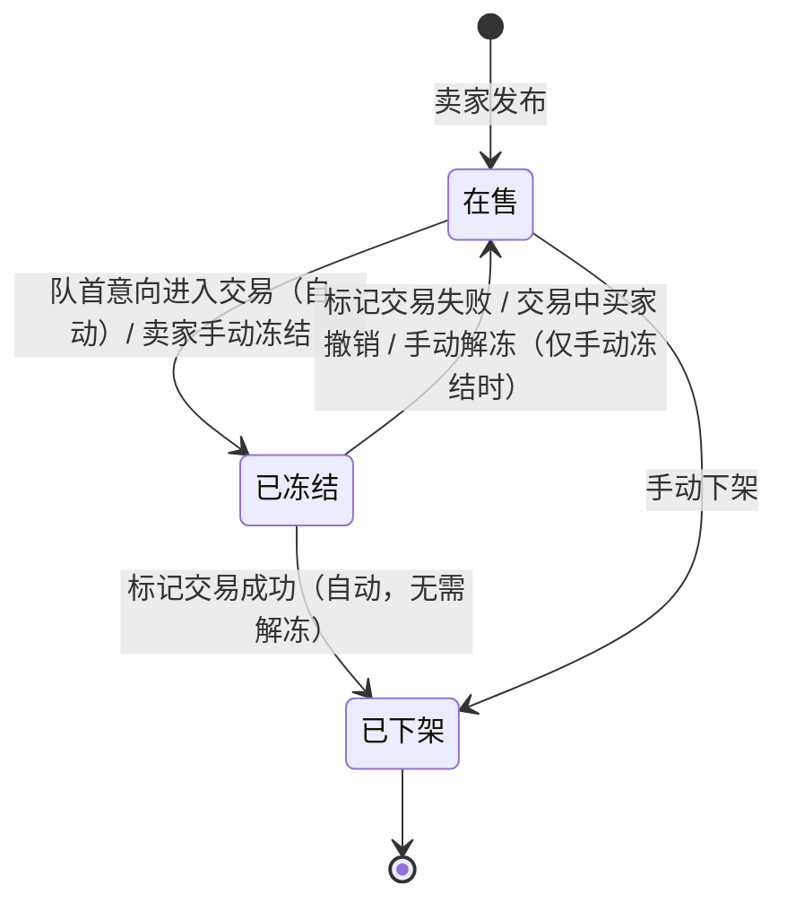
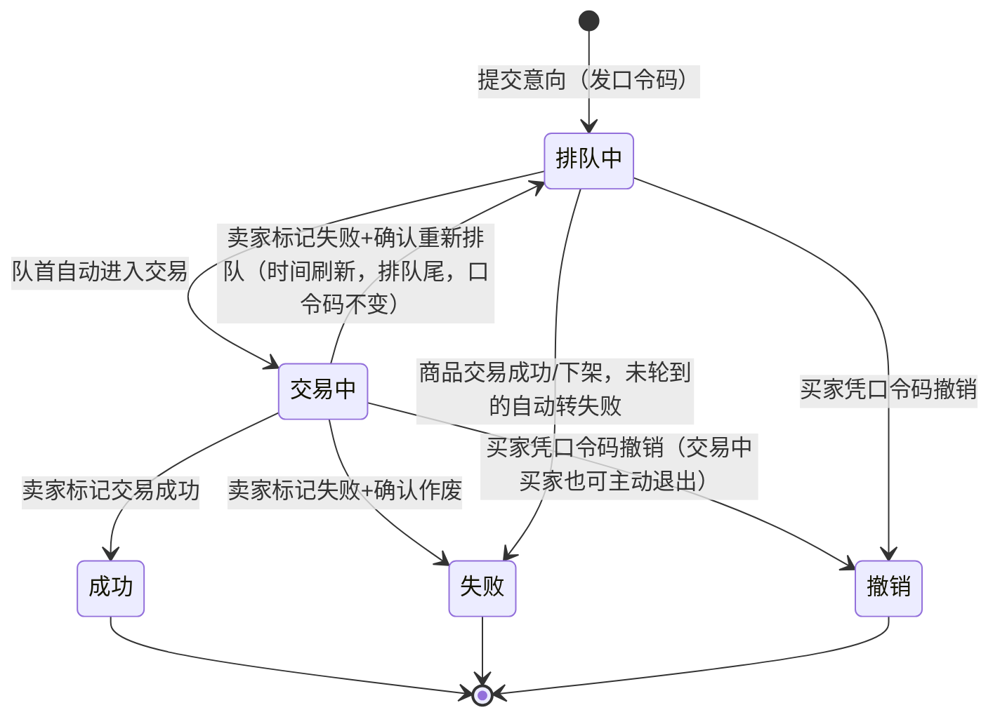
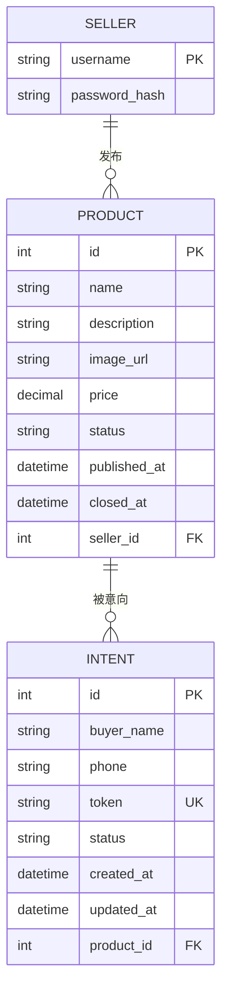
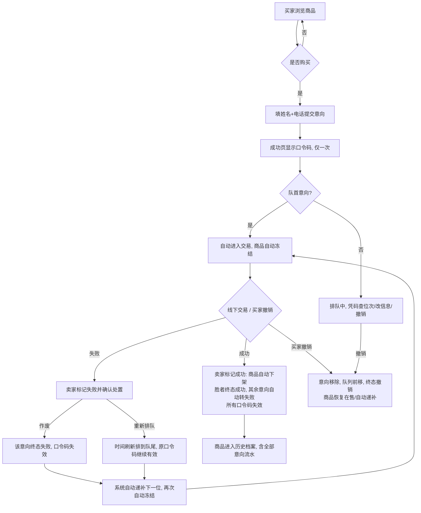

# 需求规格说明书（SRS）

**项目名称**：在线购物系统（挑战升级）
**文档版本**：v3.0（含需求澄清 + 格式整理）
**编写日期**：2026-09-29
**文档状态**：基线
**澄清来源**：https://github.com/sebestp/coursewise/wiki/需求澄清记录

---

## 1. 引言

### 1.1 编写目的
本文档作为"在线购物系统"项目的需求基线，整合需求访谈澄清结果，统一后续设计、开发、测试、验收的依据。

### 1.2 项目范围

| 类型 | 内容 |
|---|---|
| 基线需求（MVP） | 同一时间只能有**一件商品在售**（冻结时也占用该唯一位置），卖掉或下架后才能发布下一件 |
| 基线需求（MVP） | 只有**一个卖家**（账号由系统直接指定，无注册流程） |
| 基线需求（MVP） | **买家免注册**：浏览无需登录，想买时填姓名 + 联系电话即可 |
| 基线需求（MVP） | **线下交易**，一手交钱一手交货；交易结果由卖家在后台标记 |
| 基线需求（MVP） | **先到先得**：意向按提交时间排队；队首意向进入交易时商品**自动冻结**；交易失败后下一位自动递补 |
| 基线需求（MVP） | **口令码机制**：买家提交意向后获得唯一口令码，凭码查询 / 修改 / 撤销自己的意向 |
| 基线需求（MVP） | **卖家后台**：发布商品、查看意向队列、冻结/解冻、标记交易结果、手动下架、查看历史商品、修改密码 |
| 明确不做（v1） | 商品搜索与分类 |
| 明确不做（v1） | 购物车、线上支付、物流 |
| 明确不做（v1） | 库存概念 |
| 明确不做（v1） | 买家历史订单 |
| 明确不做（v1） | 商品信息修改、退出登录 |
| 明确不做（v1） | 意向人数统计 |
| 明确不做（v1） | 超时自动解冻 |
| 明确不做（v1） | 撤销"交易成功"标记 |
| 明确不做（v1） | 口令码找回 |

### 1.3 术语与缩写

| 术语 | 含义 |
|------|------|
| 口令码 | 买家提交意向时系统生成的唯一凭证，绑定意向；用于查询位次/状态、修改姓名电话、撤销意向 |
| 意向队列 | 按提交时间正序排列的购买意向；先到先得 |
| 冻结 | 商品锁定状态；停止接收新意向；手动冻结与交易冻结共用同一状态 |
| 递补 | 队首意向退出（撤销/作废/失败）后，下一位意向自动进入交易并再次自动冻结 |
| 重新排队 | 交易失败后卖家确认的处置之一：意向提交时间刷新、位次重置到队尾，原口令码继续有效 |
| 终态 | 意向的最终结果，只有三种：成功、撤销、失败 |

### 1.4 参考文献

| 序号 | 类别 | 名称 |
|------|------|------|
| 1 | 标准 | IEEE Std 830-1998 |
| 2 | 标准 | ISO/IEC/IEEE 29148:2018 |
| 3 | 课程文档 | 《系统验收标准》 |
| 4 | 课程文档 | 《环境与工具》要求 |
| 5 | 课程 Wiki | 《需求澄清记录》（16 组访谈汇总） |

---

## 2. 总体描述

### 2.1 产品视角
独立 Web 应用：买家端展示页（免注册浏览、意向提交、口令码管理）+ 卖家端后台（账号密码登录）。系统不做撮合与谈价，只做匹配与记录；实际交易与价格确认全部线下完成（价格由卖家发布时确定，买家不还价）。

### 2.2 用户特征

| 角色 | 描述 |
|------|------|
| 买家 | 匿名访问；提交意向填姓名+电话；凭口令码自助管理意向；无历史订单 |
| 卖家 | 系统唯一账号（用户名+密码）；对意向与历史记录只有查看权 |

### 2.3 假设与依赖

| 类型 | 内容 |
|------|------|
| 假设 | 买家自行保存口令码（系统不提供找回） |
| 假设 | 买卖双方可线下联系 |
| 依赖 | Docker |
| 依赖 | Maven / Ant |
| 依赖 | SQLite / MySQL |
| 依赖 | Jenkins |
| 依赖 | Git |
| 依赖 | JUnit / Selenium / JMeter |
| 依赖 | 禅道 |

### 2.4 需求约束

| 序号 | 约束项 | 要求 |
|------|--------|------|
| C1 | 语言工具链 | 课程规定的语言与工具链（Java 或 Python） |
| C2 | 安全 | 密码加密存储（不明文） |
| C3 | 持久性 | 数据持久化，重启不丢 |
| C4 | 审计 | 关键操作（发布、冻结、标记结果、改密码等）记录时间戳 |
| C5 | 交付物 | 交付物含构建（CI）、部署（Docker）、运行（自动化测试）三段 |

---

## 3. 具体需求

### 3.1 功能需求

#### 3.1.1 买家端

| 编号 | 名称 | 优先级 | 需求描述 |
|------|------|--------|----------|
| FR-01 | 浏览商品 | 高 | 免登录浏览在售商品的名称、描述、图片、价格。无在售商品时显示「暂无商品在售」；冻结期间商品仍可见但提示「商品交易中」且不可提交意向 |
| FR-02 | 提交购买意向 | 高 | 填写姓名、联系电话（均必填，无格式/长度校验要求）。提交成功页**当场显示口令码且仅显示一次**，提示买家保存；不发短信/邮件。每次提交生成一个新口令码；同一人可重复提交，系统不去重 |
| FR-03 | 凭口令码查询 | 高 | 查询自己意向的排队位次（前面还有几人）及是否已进入交易。不用于查看商品信息 |
| FR-04 | 凭口令码修改信息 | 中 | 仅可修改姓名、联系电话；修改不影响排队位次、不重新排队 |
| FR-05 | 凭口令码撤销意向 | 高 | **排队中或交易中的买家**（只要口令码未失效）均可撤销。撤销后意向从队列移除，后续位次前移，该意向终态「撤销」，口令码失效。交易中的买家撤销后，商品恢复在售并自动递补下一位 |

#### 3.1.2 卖家端

| 编号 | 名称 | 优先级 | 需求描述 |
|------|------|--------|----------|
| FR-06 | 卖家登录 | 高 | 用户名+密码登录后台；账号由系统直接指定（无注册流程）。连续错误应有防护（实现细节可议） |
| FR-07 | 发布商品 | 高 | 填名称（必填）、描述（选填）、图片（选填：最多 1 张主图，JPG/PNG，≤5MB，不传显示占位图）、价格（必填：人民币元，>0，两位小数，无上限）。已有在售/冻结商品时禁止发布，需先完成交易或手动下架。**商品发布后信息不可修改** |
| FR-08 | 查看意向队列 | 高 | 查看当前商品全部意向购买人：姓名、联系电话、提交时间，按提交时间正序。**卖家只能查看，不能修改意向**；后台不显示口令码，也无与其挂钩的标识 |
| FR-09 | 标记交易成功 | 高 | 队首意向对应的线下交易成交后，卖家标记「成功」：商品自动从冻结直接转「已下架」（无需先解冻），进入历史；胜者意向终态「成功」；**队列中其余意向自动转「失败」**；所有口令码失效。**误标记不可撤销** |
| FR-10 | 标记交易失败 | 高 | 标记「失败」时**当场确认**该意向处置：「作废」（意向终结，终态「失败」，口令码失效）或「重新排队」（时间刷新、排到队尾，**原口令码继续有效**）。确认后系统自动递补下一位进入交易并再次自动冻结；队列排空则商品恢复在售 |
| FR-11 | 手动冻结/解冻 | 中 | 在售商品可手动冻结（不要求队列为空），与交易冻结共用「已冻结」状态，买家端统一提示「商品交易中」。手动解冻**仅限无交易进行的手动冻结**；交易中的商品禁止直接解冻，必须先标记交易结果 |
| FR-12 | 手动下架 | 中 | 在售商品可由卖家主动下架（如腾出位置发布新商品），进入历史记录。下架后所有相关口令码失效 |
| FR-13 | 查看历史商品 | 高 | 历史记录 = **所有已下架商品的档案**（交易成功下架 + 手动下架），按时间倒序、可翻页。每条含名称、描述、图片、价格、发布时间、最终结果、交易时间；点进去可查看该商品**全部意向流水**：姓名、电话、提交时间、终态（成功/撤销/失败）。**口令码不进历史**。历史只读，无修改/删除 |
| FR-14 | 修改密码 | 中 | 需先验证原密码；新密码长度 ≥ 8 位。本版无退出登录功能 |

#### 3.1.3 系统自动行为

| 编号 | 名称 | 需求描述 |
|------|------|----------|
| FR-15 | 自动进入交易与冻结 | 商品在售且队列非空时，队首意向自动进入交易，商品随之自动冻结，停止接收新意向（卖家无需手动点"进入交易"） |
| FR-16 | 自动递补 | 前一交易结束（失败确认完成 / 买家撤销 / 交易成功后其余未轮到的意向）且队列仍有意向时，下一位自动进入交易并再次自动冻结；队列只剩重新排队者一人时，其立即再次进入交易 |

### 3.2 业务规则汇总

#### R1 商品状态机（三态 + 终局）

| 规则要点 | 说明 |
|----------|------|
| 库存概念 | 无 |
| 超时机制 | 无超时自动解冻 |
| 冻结提示 | 不区分手动/交易（同一状态、同一提示文案） |

#### R2 意向状态机（终态三档）

#### R3 口令码规则

| 编号 | 规则 |
|------|------|
| R3-1 | 每个意向一个唯一口令码，格式/长度需求未规定（实现自定，建议不可枚举） |
| R3-2 | 仅在提交成功页展示一次；丢失无法找回；不发短信/邮件 |
| R3-3 | 用途仅限：查位次与状态、改姓名电话、撤销意向 |
| R3-4 | 卖家不可见，后台不显示，不进历史记录 |
| R3-5 | 失效场景：意向终态为成功/撤销/失败（含作废）、或商品下架 |
| R3-6 | **重新排队后原口令码继续有效**（口令码绑定意向，不绑定单次交易） |
| R3-7 | 失效/输错的提示文案：需求未规定，实现自定（建议区分提示） |

#### R4 历史记录模型（最终拍板）

| 维度 | 规则 |
|------|------|
| 记录主体 | 按**商品**记：所有已下架商品都进历史 |
| 下架类型 | 含交易成功下架 + 手动下架 |
| 流水内容 | 每商品档案下挂**全部意向流水**：姓名 + 电话 + 提交时间 + 终态 |
| 终态分档 | 仅三档：成功、撤销、失败 |
| 成功条件 | 全系统每商品最多一个 |
| 撤销含义 | 买家主动退出 |
| 失败含义 | 其余所有：交易失败作废、没轮到被挤掉 |
| 重新排队 | 买家侧同一口令码不变；卖家侧因时间刷新，历史按新提交时间**另记一条** |
| 旧记录状态 | 旧记录终态「失败」，新记录独立落终态 |
| 保留期限 | 意向信息永久保留、不自动删除、重启不丢 |
| 读写权限 | 历史只读 |

### 3.3 非功能需求

| 编号 | 类别 | 描述 |
|------|------|------|
| NFR-01 | 性能 | 首屏加载 < 2s；接口 P95 < 500ms |
| NFR-02 | 安全 | 密码加密存储；参数化查询防注入；口令码不可被枚举 |
| NFR-03 | 可用性 | 关键操作有成功/失败反馈；口令码页面明显提示"仅显示一次，请保存" |
| NFR-04 | 可维护性 | 核心模块单元测试覆盖率 ≥ 60% |
| NFR-05 | 可移植性 | Docker 一键部署 |
| NFR-06 | 持久性 | 数据持久化，重启不丢；发布/冻结/标记结果/改密码等关键操作记录时间戳 |

### 3.4 外部接口

| 接口类型 | 名称 | 内容 |
|----------|------|------|
| UI（买家） | 商品展示页 | 含"暂无商品/交易中"态 |
| UI（买家） | 意向提交页 | 填姓名、电话并提交 |
| UI（买家） | 口令码展示页 | 提交成功页展示口令码，仅一次 |
| UI（买家） | 凭码管理页 | 凭码查询/修改/撤销意向 |
| UI（卖家） | 登录页 | 用户名+密码 |
| UI（卖家） | 发布商品 | 名称/描述/图片/价格 |
| UI（卖家） | 意向队列 | 查看全部意向 |
| UI（卖家） | 冻结/解冻 | 手动切换商品状态 |
| UI（卖家） | 交易结果标记 | 含作废/重新排队确认 |
| UI（卖家） | 手动下架 | 卖家主动撤下在售商品 |
| UI（卖家） | 历史商品 | 含全部意向流水 |
| UI（卖家） | 修改密码 | 验原密码 + 新密码 |
| 软件 | 数据库 | MySQL / SQLite |
| 通信 | 协议 | HTTP/HTTPS，REST 风格 |

### 3.5 数据需求

#### ER 图

| 实体 | 字段 | 取值 |
|------|------|------|
| 商品 | status | ONLINE（在售）/ FROZEN（已冻结）/ OFFLINE（已下架） |
| 意向 | status | QUEUED（排队中）/ TRADING（交易中）/ SUCCESS（成功）/ CANCELLED（撤销）/ FAILED（失败） |
| 意向 | created_at | 排序基准；重新排队时刷新该时间实现"排到队尾" |

#### 业务流程图（核心交易闭环）

---

## 4. 验收准则

每条功能需求必须满足：

| 序号 | 验收项 | 说明 |
|------|--------|------|
| V1 | 可复现 | 在最新 `main` 分支代码可复现 |
| V2 | 有测试 | 对应单元测试或 UI 测试已实现且通过 |
| V3 | 异常处理 | 异常路径有明确错误提示，无未捕获异常 |
| V4 | 一致性 | 与本文档描述一致，无遗漏功能 |

### 4.1 关键场景验收（必须覆盖）

| 编号 | 场景 |
|------|------|
| A1 | 提交意向 → 成功页展示口令码（仅一次）→ 凭码查位次、改姓名电话、撤销 |
| A2 | 多人排队 → 队首自动进入交易并冻结 → 冻结期间新意向被拒（提示"商品交易中"）|
| A3 | 交易失败 + 作废 → 意向终态"失败"、口令码失效 → 下一位自动递补并再次冻结 |
| A4 | 交易失败 + 重新排队 → 原口令码仍可查询 → 位次在队尾 → 历史中按新时间另记一条 |
| A5 | 交易成功 → 商品自动下架 → 其余意向自动转"失败" → 全部口令码失效 → 历史档案完整 |
| A6 | 手动冻结 → 买家提示"商品交易中" → 手动解冻恢复在售 |
| A7 | 交易中点手动解冻 → 被拒绝，提示需先标记交易结果 |
| A8 | 已有在售商品时发布新商品 → 被拒绝 |
| A9 | 历史商品点开可见全部意向流水（姓名/电话/时间/终态），无口令码，只读 |
| A10 | 密码修改需验原密码，新密码 ≥ 8 位 |
| A11 | 交易中的买家凭口令码撤销 → 意向终态"撤销" → 商品恢复在售/自动递补下一位 |

### 4.2 非功能验收

每条非功能需求必须满足：有可量化度量指标 + 测试报告或运行时数据佐证。

| 类别 | 度量要求 |
|------|----------|
| 性能 | 首屏加载时间、接口 P95 时延 |
| 安全 | 密码哈希值验证、无 SQL 注入漏洞扫描报告 |
| 可用性 | 关键操作反馈记录 |
| 可维护性 | 单元测试覆盖率报告 |
| 可移植性 | Docker 镜像部署验证记录 |
| 持久性 | 重启前后数据比对记录 |

---

## 5. 附录

### 5.1 需求澄清记录（汇总自课程 Wiki，2026-09-29 版）

| 主题 | 澄清结论 | 来源小组 |
|------|----------|----------|
| 意向字段 | 仅姓名+电话，均必填，无格式校验、无地址 | 第1、6、8、11组 |
| 意向保留 | 成交后不删，永久保留在商品历史档案中 | 第2、8组 |
| 口令码交付 | 提交成功页仅显示一次，买家自存；丢失无法找回 | 第4、8、11组 |
| 口令码归属 | 买家专属；卖家不使用、不可见，后台无关联标识 | 第4组 |
| 口令码数量 | 一意向一码；同人多次提交得多个码，系统不识别同人 | 第4、8组 |
| 队列排序 | 提交时间正序、先到先得；无其他排序 | 第4、8组 |
| 卖家对意向 | 只能查看，不能修改 | 第4、8、14组 |
| 买家可改信息 | 仅姓名、电话；不影响位次 | 第4、8、14组 |
| 冻结时机 | 进入交易才自动冻结（提交意向不冻结） | 第4、8、11、14组 |
| 冻结期表现 | 商品可见、提示"商品交易中"、拒绝新意向；手动/交易冻结不区分文案 | 第4、14组 |
| 冻结期撤销 | 排队中及交易中的买家，只要口令码未失效，均可凭口令码撤销意向；撤销后队列前移、自动递补 | 本次澄清 |
| 解冻路径 | 交易失败自动恢复在售；手动解冻仅限无交易的手动冻结；交易中禁止手动解冻（漏洞修正） | 第4、9、11组 |
| 交易结果标记 | 仅成功/失败两档，只能卖家标记；失败时当场确认作废或重新排队 | 第4、6、8、9组 |
| 重新排队 | 排到队尾、时间刷新、位次重置；原口令码继续有效；卖家历史按新时间另记一条 | 第4、8、11组 |
| 无超时机制 | 冻结不会自动超时，推进全靠卖家操作 | 第11组 |
| 交易成功连锁 | 商品自动下架（冻结→下架直达）；其余排队意向自动转"失败" | 第4、11组 |
| 误操作 | 标记成功后不可撤销；商品发布后不可修改 | 第8、11、14组 |
| 历史记录定义 | = 所有已下架商品档案；含交易成功下架与手动下架；每商品挂全部意向流水 | 第4组 |
| 意向终态 | 仅成功/撤销/失败三档；"重新排队"非终态 | 第4组 |
| 历史不记口令码 | 已失效且属买家私有凭证 | 第4组 |
| 已撤销意向 | 实时队列消失，历史留痕标"撤销" | 第4组 |
| 单在售商品 | 同一时间仅一件在售/冻结；下架后才能发新 | 第8、11组 |
| 商品字段约束 | 名称必填；描述选填；图片选填（1张、JPG/PNG、≤5MB、占位图）；价格>0、两位小数、人民币 | 第11、14组 |
| 卖家账号 | 系统直接指定单账号，无注册、无退出登录 | 第8、11组 |
| 密码规则 | 改密验原密码，新密码≥8位 | 第8、11组 |
| 买家能力边界 | 无历史订单；口令码仅管自己意向，不看商品；不展示售出商品 | 第4、8、11组 |
| 并发提交 | 按提交时间先后排队，无特殊冲突处理 | 第8、11组 |

### 5.2 仍待澄清问题（TBD）

| 编号 | 问题 | 现状 |
|------|------|------|
| T1 | 「进入交易」的触发细节：多组澄清为系统自动（队首自动进入交易），但第4组表示"具体谁来触发还没想细"；本版按**自动**处理 | 建议与助教最终确认 |
| T2 | 手动下架的前置条件（是否要求队列为空）及队列中未处理意向的终态归属 | 需求未写死 |
| T3 | 口令码格式、长度、生成规则 | 仅要求唯一，实现自定 |
| T4 | 口令码"输错"与"已失效"的提示文案区分 | 实现自定 |
| T5 | 卖家初始账号的生成与发放方式 | 未规定 |
| T6 | 密码复杂度（是否要求大小写/数字/符号） | 仅确定长度≥8 |
| T7 | 历史商品中"手动下架"的最终结果字段如何标注（与"交易成功"区分） | 需求缺口 |

### 5.3 后续工作

| 序号 | 工作项 | 说明 |
|------|--------|------|
| W1 | 系统设计说明书（SDD） | 重点设计意向状态机与队列递补的并发正确性 |
| W2 | API 接口文档 | RESTful 接口定义 |
| W3 | 禅道任务拆分 | 把 FR 拆成具体开发任务 |
| W4 | Jenkins CI 配置 | 自动化构建与测试 |
| W5 | Docker 镜像构建 | 部署交付物 |

---

**说明**：本文档图表使用 Mermaid 语法，可在 GitHub / VSCode / Typora 中直接渲染。